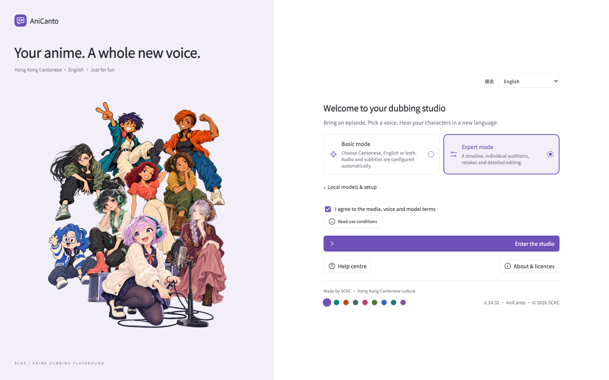
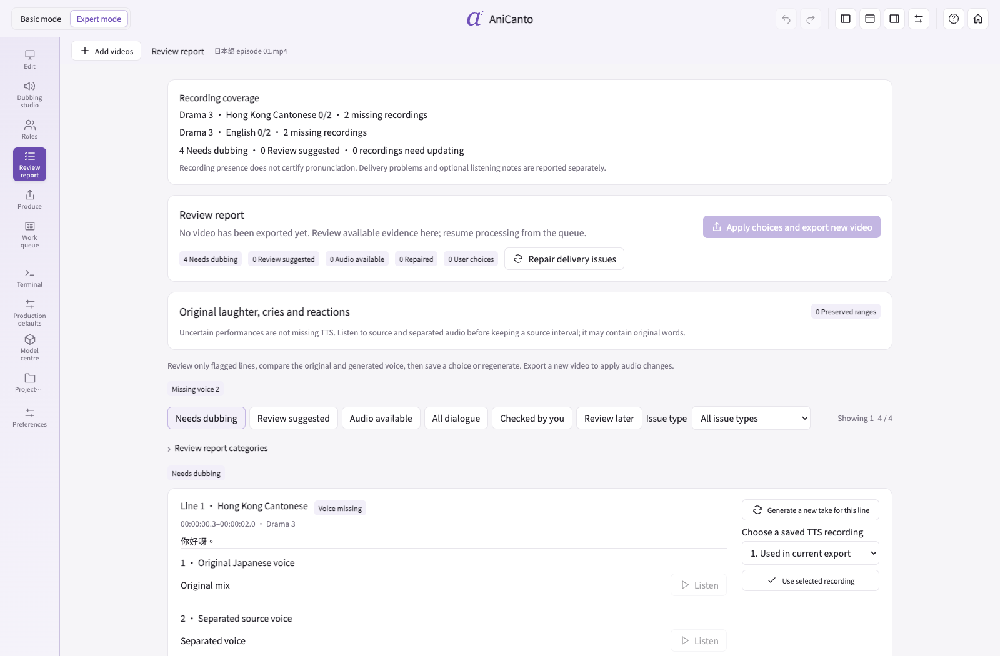

**English** · [繁體中文](README.zh-HK.md) · [简体中文](README.zh-CN.md) · [日本語](README.ja.md)

# AniCanto

**Your anime. A whole new voice.**

Turn Japanese anime dialogue into **Hong Kong Cantonese or English dubbing**. Recognition, translation, speech generation and export run locally after models and runtimes are installed.

[Download](#download-the-beta--02459) · [Features](#what-the-app-does) · [Workflow](#from-video-to-a-new-voice) · [Screenshots](#inside-the-current-app) · [Support](#help-more-people-discover-cantonese)

## Why AniCanto exists

AniCanto began with a simple wish: **to let children enjoy animation in everyday Hong Kong Cantonese while following Chinese subtitles and becoming familiar with Chinese characters.** Familiar stories and characters can make a language feel closer, bringing its rhythm, expressions and humour into everyday life.

Created by SCKC as a personal learning project, AniCanto also welcomes anyone curious about Cantonese. Whether you are sharing the language with your children or comparing Cantonese, English and Japanese to discover new expressions, the hope is to make Hong Kong Cantonese culture a little more accessible through the stories you enjoy.

AniCanto 最初只係一個簡單嘅心願：**希望小朋友睇動畫時，可以聽到日常香港廣東話，同時跟住中文字幕認識漢字。** 熟悉嘅故事、角色同對白，可以令接觸語言變得親切一點，亦讓廣東話嘅節奏、語氣同幽默喺生活入面延續落去。

呢個由 SCKC 以個人興趣同學習心態建立嘅小作品，亦希望將呢份樂趣分享俾更多人。無論係陪小朋友接觸廣東話，定係自己想透過廣東話、英文同日文對照認識新詞句，都可以由熟悉嘅一幕開始，慢慢感受香港廣東話嘅表達同文化。

## With respect to professional voice performers

**AniCanto is for language learning and creative experimentation. It is not intended to replace professional voice actors.** Character interpretation, emotion, timing and dramatic intent are creative skills; AI-generated speech should not be equated with a professional performance. Please continue to appreciate and support the performers behind the voices you love.

AniCanto 以語言學習同創作實驗為本，並非用嚟取代專業配音員。角色演繹、情緒、節奏同戲劇張力都係配音員嘅專業；AI 生成聲音唔等同真人演出，希望大家繼續欣賞同支持背後嘅表演者。

## Download the Beta · 0.24.59

**[Download for Mac](https://github.com/samuelkcc/AniCanto/releases/download/v0.24.59-beta/AniCanto-macOS-0.24.59.zip)** · **[Download for Windows](https://github.com/samuelkcc/AniCanto/releases/download/v0.24.59-beta/AniCanto.exe)** · [Release notes & matching source](https://github.com/samuelkcc/AniCanto/releases/tag/v0.24.59-beta)

## What’s new in this Beta

- Basic mode now fills the workspace, with a flexible preview above progress and line audition.
- Expert mode has a full-window timeline at the bottom; progress sits directly below the preview.
- Refreshed light-purple screenshots and four-language pages, with English as the default and a bilingual introduction.

## Choose your computer setup

**Preferred voice model: full Drama 3.** Pair it with Qwen 3.5 for translation: 35B is recommended on a 64 GB Mac; 9B is a smaller option for Windows with 32 GB RAM. Drama 3 sounded closer to Hong Kong Cantonese in developer listening tests; results still depend on the source and scene.

| Platform | Recommended system and memory | How Drama 3 runs |
| --- | --- | --- |
| **Mac** | Apple Silicon, macOS 14+; **64 GB+ unified memory recommended** | Full 4-bit MLX on Apple Silicon GPU / unified memory; approximately 28 GB estimated |
| **Windows** | Windows 10 / 11 x64; **32 GB RAM minimum, 64 GB offers more headroom** | Full GGUF Q2 **on the CPU**; approximately 22 GB system RAM estimated |

**On Windows, Drama 3 currently has no NVIDIA, AMD or Intel GPU acceleration.** Even with a dedicated graphics card, Drama 3 uses the CPU and system RAM. Other supported models may use the GPU depending on the card and driver; dedicated VRAM does not replace the RAM Drama 3 needs. This exact Windows package still needs testing on a Windows PC.

A 32 GB Mac can attempt a smaller translation-model combination, but Drama 3 may cause swapping, severe slowdown or loading failure. Memory figures are planning estimates. Allow **100 GB+ free storage** for models, runtimes and working files; long videos need more.

Other voice options include **GPT-SoVITS V2 Pro Plus, GPT-SoVITS V4 and CosyVoice 3**, subject to platform and runtime compatibility. They are alternatives to explore, not extra models you must download. Accents, expression and voice similarity can differ between engines.

## What the app does

| Feature | How you can use it |
| --- | --- |
| **Cantonese / English dubbing** | Choose either language or both, with separate audio and subtitle tracks in one movie, switchable in a compatible player. |
| **Chinese subtitles as context** | Use embedded text tracks, external subtitles or screen OCR to help check names and meaning. Japanese speech remains the primary source. |
| **Opening and ending preservation** | Automatically detect OP / ED regions and keep their original Japanese songs and audio by default. |
| **Basic and Expert modes** | Start with automatic processing, or use the timeline to edit scripts, adjust timing and work on individual lines. |
| **Audition, retake and review** | Compare original, separated and generated speech; retake a line or choose a saved recording, then export another version while retaining the previous movie. |
| **Local batch processing** | Queue videos, reorder waiting items, pause, save and resume. Processing can run offline after model setup. |
| **Model & download management** | See installed models, missing downloads and estimated memory needs; check or repair files before switching. |
| **Saved projects & versions** | Keep scripts, recordings and review notes together. Make another export without overwriting the previous movie. |

### AI automatic repair

In Normal mode, AniCanto checks generated speech and tries to fix affected lines automatically:

1. **Check** — Compare the recording with the script for missing speech, wrong language, missing words and timing problems.
2. **Repair** — Retry affected lines, adjust wording or timing when needed, and try another installed model or fallback voice where enabled.
3. **Review** — Open the review report for remaining issues. Listen, retake or choose a saved recording, then export a new version while keeping the previous movie.

Accent, expression and voice similarity still need a listening check.

### Experimental: other source languages

Beyond Japanese animation, AniCanto can try converting other detected source languages into Cantonese when the selected engine supports them. **Success is not guaranteed. Only English-to-Cantonese has received limited testing and targeted optimisations so far.** This is an experimental option, not verified support for every language or video.

## Your subtitles, your language tracks

AniCanto uses **spoken dialogue as the primary source**, with subtitles helping it check meaning and names. A Chinese subtitle track is reference material, not a promise that the same wording will be read verbatim.

| Source or output | What happens |
| --- | --- |
| **External subtitle file** | Use **Subtitle source → Import subtitle file** to attach SRT, ASS, SSA or VTT to the selected video. |
| **Embedded text subtitles** | Read available text tracks inside containers such as MKV and MP4. |
| **Burned-in Chinese captions** | Try OCR when readable text tracks are unavailable. Picture quality and layout affect recognition. |
| **Original, Cantonese and English tracks** | Keep the original audio if selected, add one or both dubbing languages, and choose independent or bilingual learning subtitles. Switch tracks in a compatible player. |

Automatic subtitle selection checks a matching external file, then embedded text, then screen OCR. **Original subtitle timestamps are preserved separately from dubbing timing.** Changing the interface language does not change the languages of the finished movie.

## Supported formats

| Type | Formats |
| --- | --- |
| **Video input** | MP4 · MKV · MOV · M4V · AVI · WebM · TS |
| **External subtitles** | SRT · ASS · SSA · VTT |
| **Finished output** | MP4 with the selected audio and subtitle tracks. |

An accepted extension still needs readable audio and video codecs. Burned-in captions can be read with OCR, but cannot always be cleanly removed from the picture.

## From video to a new voice

1. **Import & prepare** — Add videos, inspect audio/subtitles and download any missing models.
2. **Listen & translate** — Recognise the source dialogue, prepare separated speech references and write Cantonese and/or English scripts with available subtitle context.
3. **Generate & check** — Create speech, preserve detected OP/ED audio and try bounded local repairs where needed.
4. **Export & review** — Save a new MP4 with the chosen tracks. Use the review report to inspect remaining notes when you want to improve a line.

### Improve a scene without starting again

| What you want to change | Where to work |
| --- | --- |
| Hear the difference | Compare the original mix, separated dialogue and saved generated recordings in **Review report**. |
| Fix one line | Edit its script or settings in **Expert mode**, generate a new take and listen before exporting. |
| Use an earlier recording | Choose a retained take in **Review report**, then apply your choices to a new export. |
| Change production or language tracks | Use **Production defaults / Produce** for a new version; reuse saved project material where it remains valid. |
| Leave a note for later | Mark a review item checked or deferred. The report keeps the evidence available. |

Recordings and previous exports are retained. New languages, models or changed scripts may still need translation or speech generation; reusing a project does not make every change instant.

## Start in three steps

1. Download and open the app, then prepare the models and runtimes. Initial setup needs internet access.
2. Add videos and choose Cantonese, English or both. For external subtitles, use **Subtitle source → Import subtitle file** above the preview (SRT / ASS / SSA / VTT).
3. Start processing and play the finished movie. Use the review report to compare original, separated and generated speech, retake a line or select an earlier recording, then export another version.

[Subtitle import guide](docs/en/GETTING-STARTED.md)

## Inside the current app

Editing screenshots show **video preview switched off, with the animated assistant visible**, in the light-purple theme. Project and model states are illustrative, not conversion benchmarks.

### Welcome and setup

Choose the interface language, prepare local models, and enter Basic or Expert mode.

### Basic mode: progress and audition

Add a queue, choose dubbing languages and an output folder, then follow processing and audition individual lines. Preview can stay off while the assistant keeps you company.

### Expert mode: timeline and line editing

Use the full-width timeline to compare source dialogue and dubbing scripts, adjust timing and generate another take for a selected line.

### Review report: issues and recording comparison

See what was flagged and what was tried. Compare retained recordings, make a choice and export another version while keeping the previous movie.

[See every interface screenshot](docs/en/SCREENSHOTS.md)

## A work in progress, shaped by listening

AniCanto has grown through listening to failed conversions, comparing individual recordings and improving how difficult scenes are handled. Animation is demanding: whispers, shouting, overlapping voices, music and dramatic changes in delivery all affect recognition and voice references. A fix for one scene still needs checking against others.

Normal mode uses source references per line; **it does not guarantee one identical voice for a character throughout an episode**. Full AI review offers character analysis and reference organisation, but speaker identity can still be misclassified. Automated checks can help find problems; they cannot judge a performance the way a listener can.

<strong>Do review notes mean the finished movie is unusable?</strong>

A saved movie can still be played while notes remain. The report tells you which lines may need attention and lets you compare them. A fallback may use another voice or original speech according to your settings; an exported file is not proof that every line has been dubbed correctly.

<strong>Why can a conversion take a long time?</strong>

Dialogue density, model loading, memory pressure, separation and repeated speech generation all affect the time. Full Drama 3 uses the CPU on Windows and can be very slow. More unused RAM does not itself make inference faster; there is no fixed conversion-time promise.

<strong>Does my video need to go to a cloud service?</strong>

No cloud translation or dubbing service is required for this workflow. Once models and runtimes are installed, recognition, translation, speech generation and export run locally. Initial downloads, repairs and app updates need internet access.

## Before you start

AI can still produce accents, mistranslations, missing words and voice changes. Listen to important scenes. Subtitles help check meaning; Japanese speech remains the primary source. The app supports separate original, Cantonese and English tracks and OP / ED preservation; results vary by scene.

A hobby project by SCKC. Original code uses MIT; third-party components and models retain their own terms. Built with Fish Audio; Drama 3 uses the Fish Audio Community License 1.0. Use only video, subtitles and voices you have permission to process.

## Help more people discover Cantonese

If AniCanto helps you share Cantonese with your children, learn a new expression or enjoy a familiar scene in another voice, you are welcome to support this independent project. A coffee is a voluntary way to encourage more testing and development. Thoughtful bug reports and feedback are just as welcome.

Made by **SCKC** — for the joy of hearing a familiar story in Cantonese.

[MIT](LICENSE) · [Licences](docs/LICENSING.md)
