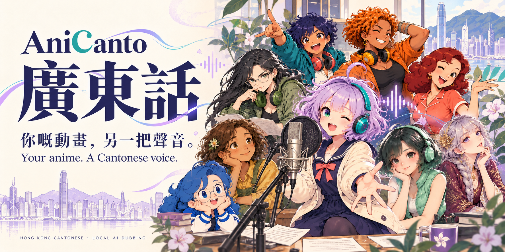
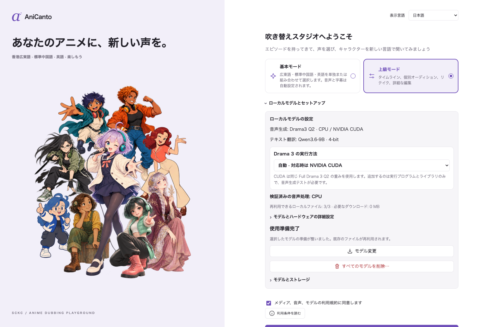
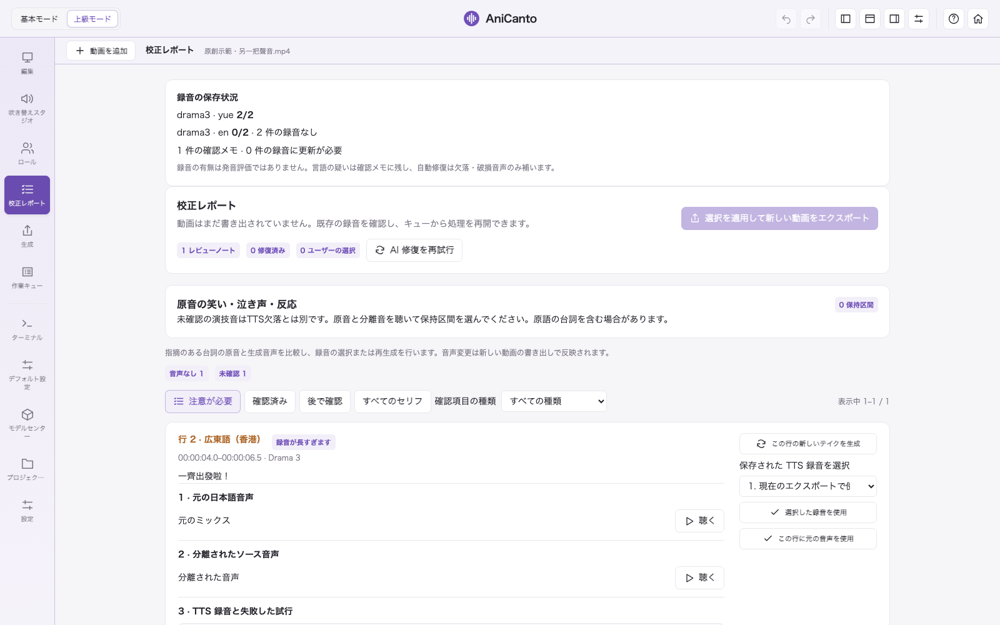

[English](README.md) · [繁體中文](README.zh-HK.md) · [简体中文](README.zh-CN.md) · **日本語**

# AniCanto

**あなたのアニメに、新しい声を。**

日本のアニメのセリフを**香港広東語・中国本土普通話・英語の吹き替え**に変換します。モデルと実行環境の準備後は、認識・翻訳・音声生成・書き出しをすべてローカルで実行します。

[ダウンロード](#beta-をダウンロード--02468) · [機能](#アプリでできること) · [処理の流れ](#動画から新しい声へ) · [画面](#現在のアプリ画面) · [サポート](SUPPORT.ja.md) · [応援](#広東語に出会うきっかけを増やすために) · [iPad プライバシーポリシー](docs/IPAD-PRIVACY-POLICY.ja.md)

## AniCanto を作った理由

AniCanto は、**子どもがアニメを楽しみながら日常の香港広東語を聞き、中国語の字幕を通じて漢字に親しめたら**という、小さな願いから始まりました。見慣れた物語やキャラクターは、言葉のリズム、表現、ユーモアを身近に感じるきっかけになります。

SCKC が趣味と学びのために作っているこのプロジェクトは、広東語に興味のある人にも開かれています。子どもと一緒に広東語に触れたり、広東語・英語・日本語を比べて新しい表現を見つけたりしながら、好きな場面を通じて香港広東語の文化に親しんでもらえたらと考えています。

## プロの声優への敬意

**AniCanto は言語学習と創作実験のためのもので、プロの声優に代わることを目的としていません。** キャラクターの解釈、感情、間の取り方、演劇的な表現は、声優の訓練と創造性によって生まれます。似た声を生成するだけで、その演技を再現できるわけではありません。

AI の生成音声には、アクセント、読み間違い、演技の不足などが残る場合があります。作品を楽しむとともに、その声を届けるプロの演技を、これからも大切にし、応援してください。

## Beta をダウンロード · 0.24.64

**[Mac 版](https://github.com/samuelkcc/AniCanto/releases/download/v0.24.68-beta/AniCanto-macOS-0.24.68.zip)** · **[Windows 版](https://github.com/samuelkcc/AniCanto/releases/download/v0.24.68-beta/AniCanto.exe)** · [更新内容と対応するソース](https://github.com/samuelkcc/AniCanto/releases/tag/v0.24.68-beta)

[対応ソース・第三者ソースをダウンロード](https://github.com/samuelkcc/AniCanto/releases/download/v0.24.68-beta/available-source-materials.tar.gz) · [ソースの保管と再ビルド](docs/BUILD-AND-RECOVERY.md)

## 今回の Beta の変更点

- **高速モードでも元の演技を保護：**笑い声・泣き声・呼吸の追加復元を有効にし、品質判定による再生成は追加しません。Windows の分類ラベル対応を修正。
- **出力サンプルレートを保持：**元の演技の復元時に Drama 3／GPT V4 のミックスを 24 kHz に固定しません。分類結果は音声トラック間で再利用します。
- **共通の修復仕様を文書化：**最初の有声音声を保持し、無音・破損のみ自動修復。実測で長い台詞は上限付きで短縮します。Mac／Windows の差異と iPad の未検証項目を明記。

## パソコンの推奨構成

**推奨音声モデル：完全版 Drama 3。** 翻訳には Qwen 3.5 を使用し、64 GB Mac では 35B、32 GB RAM の Windows では小さめの 9B が選択肢です。開発者の試聴では Drama 3 が香港広東語に近い発音でしたが、元音声や場面によって結果は異なります。

| 環境 | 推奨システム・メモリ | Drama 3 の実行方法 |
| --- | --- | --- |
| **Mac** | Apple Silicon、macOS 14 以降。**64 GB 以上のユニファイドメモリを推奨** | 完全版 4-bit MLX。Apple Silicon GPU／ユニファイドメモリを使用。推定約 28 GB |
| **Windows** | Windows 10／11 x64。**RAM 32 GB 以上、64 GB なら余裕あり** | 完全版 GGUF Q2：対応 NVIDIA では **CUDA**、AMD／Intel／内蔵 GPU では CPU。システム RAM も必要です。 |

**Windows の完全版 Drama 3 Q2 で NVIDIA CUDA を選択できるようになりました。** モデル設定の **Drama 3 の処理方式 → 自動**、または **NVIDIA · CUDA** を選択します。自動では、デバイス・メモリ・導入確認を通過した場合に CUDA を使用します。AMD／Intel／内蔵 GPU は CPU を選んでください。システム RAM と VRAM を別表示し、対応する高速化プログラムとライブラリを追加します。同じ Q2 重みを再利用するため、モデルの再ダウンロードは不要です。対応する NVIDIA ドライバーが必要です。

作者の Windows での初期テストでは、CUDA による Drama 3 の生成速度が明らかに改善しました。一定の倍率や全 GPU での互換性を保証するものではありません。**一部の認識・確認処理は引き続き CPU を使用し、全工程が GPU 化されたわけではありません。**

32 GB Mac でも小さな翻訳モデルとの組み合わせを試せますが、Drama 3 によりスワップ、大幅な速度低下、読み込み失敗が起こる場合があります。メモリ値は計画用の推定です。モデル・実行環境・作業ファイル用に **100 GB 以上の空き容量**を推奨します。長い動画には追加容量が必要です。

ほかに **GPT-SoVITS V2 Pro Plus、GPT-SoVITS V4、CosyVoice 3** などを選択できます。利用可否は OS と実行環境によります。すべてのモデルをダウンロードする必要はありません。アクセント、表現力、声の似かたはエンジンごとに異なります。

### 繰り返し試聴して選んだモデル

場面ごとの比較を繰り返した結果、**AniCanto で試したモデルの中では、完全版 Drama 3 が作者の期待する香港広東語の発音に最も近い結果でした**。他の TTS は日本語キャラクターの声質や表情を再現できる一方、広東語に日本語の発音・イントネーションが混ざる場合があります。これは作者個人の試聴による評価であり、独立したベンチマークや全ての声への保証ではありません。Drama 3 でも読み間違い、表現不足、再生成が必要な場合があります。

### 作者のテスト環境と利用時の目安

作者は **MacBook Pro M2 Max・64 GB ユニファイドメモリ**と、**NVIDIA 独立 GPU（16 GB VRAM）・32 GB システム RAM の Windows ノート PC**でテストしています。リリースの検証基準は両機で読み込みから出力までの変換を完了することです。未完了のプラットフォーム確認は各リリースノートに記載します。Windows の NVIDIA CUDA 更新は作者の初期デスクトップテストを通過し、生成速度の改善を確認しました。結果はテストした構成・作業に限られ、他の構成からの報告も歓迎します。この2台の結果が全ての構成への対応を証明するものではありません。

**M2 Max と完全版 Drama 3 を使った作者の実測目安は、動画時間と処理時間が約 1:2**です。30分の動画に約60分を要し、そのテストでは台詞の約8〜10%に対する AI 自動修復も含んでいます。速度の保証や Windows の所要時間ではありません。場面、モデル設定、修復回数、ストレージ、メモリ負荷によって大きく変わります。

別の構成で互換性の問題が起きた場合は、[不具合報告](https://github.com/samuelkcc/AniCanto/issues)にアプリ・OS のバージョン、CPU、RAM、GPU／VRAM、選択モデル、停止・遅延した段階を記載してください。個人情報を除いた診断ログが役立ちます。私的な動画や録音を公開する必要はありません。

## アプリでできること

| 機能 | 使い方 |
| --- | --- |
| **広東語／普通話／英語の吹き替え** | 1言語、2言語、3言語の組み合わせを選択。1 本の動画に個別の音声・字幕トラックを保存し、対応プレーヤーで切り替えられます。 |
| **中国語字幕で意味を確認** | 内蔵テキスト字幕、外部字幕、画面 OCR を人名や意味の確認に活用。日本語音声を主な根拠にします。 |
| **オープニング・エンディングの保持** | OP／ED を自動検出し、標準で元の日本語の歌と音声を保持します。 |
| **基本・エキスパートモード** | 自動処理から始め、必要に応じてタイムラインで台本・タイミング・各セリフを編集できます。 |
| **試聴・再生成・校正** | 元音声・分離音声・生成音声を比較。1 行を再生成したり過去の録音を選び、以前の完成動画を残して別バージョンを書き出せます。 |
| **ローカルで一括処理** | 動画をキューに追加し、未開始の動画を並べ替え、一時停止・保存・再開。モデル準備後はオフラインでも処理できます。 |
| **モデル・ダウンロード管理** | 導入済みモデル、残りのダウンロード量、推定メモリを確認。切り替え前にファイルの検査や修復が可能。 |
| **プロジェクトと履歴の保存** | 台詞・録音・校正記録を保持し、以前の動画を上書きせず新版を書き出し。 |
| **独立した吹き替えスタジオ** | 文章や録音から編集可能な広東語音声を作成。録音版の保存、対訳学習、WAV書き出しに対応。 |

### 新機能：動画を普通話で吹き替え

**制作設定 → 吹き替え言語**で **中国本土普通話**を単独で選ぶか、香港広東語・英語と組み合わせます。3言語をすべて生成することも可能です。普通話は独立した台本と録音を持ち、中国本土の表現と簡体字字幕を使用。選択に応じて元音声も保持し、対応プレーヤーでトラックを切り替えられます。

動画の基本・エキスパート両モードで利用可能。UI言語の変更だけでは音声トラックは追加されません。**独立した吹き替えスタジオの出力は現在も広東語**です。公開済み比較動画は広東語・英語・日本語のままです。

### 吹き替えスタジオ：文章や録音からクリップを作成

**基本・エキスパート両モードで利用でき**、動画の読み込みは不要です。日本語・英語の文章を入力するか、自分の声を録音・読み込みます。録音の言語は自動判定し、対応範囲は導入済みモデルによります。

1. **確認・翻訳** — 認識された原文を修正し、ローカル翻訳モデルで広東語に翻訳して台詞を編集します。
2. **生成・試聴** — 導入済みの音声エンジン、テンプレート参照、対応する録音声を選び、話速や対応パラメーターを調整します。声の模倣には明瞭で完結した3〜10秒の参照が必要です。
3. **保存・比較** — 専用分類に各録音版を保存します。元音声・生成音声と対訳を比較し、再生速度、部分ループ、改名、WAV書き出し、特定の版だけの削除ができます。分類名は UI 言語に連動します。

生成後に独立した認識で語句・言語を確認します。自動修復は確認された失敗部分だけ最大2回追加生成し、表記の違いだけでは声を置換しません。注意付き録音は聴いて明示的に承認して保存でき、以前の版も保持します。

### AI による自動修復

通常モードは最初の有声音声を優先して保持します。

1. **保持** — 有声音声を使用し、言語・アクセント・語の欠落の疑いは確認メモに残します。
2. **補完** — 無音・破損だけ最大2回追加生成します。言語の疑いでは再生成しません。実測で長すぎる台詞は意味を保って短縮し、時間内に収まる音声のみ採用します。
3. **必要時に確認** — 行ごとに試聴し、保存済み音声の選択や手動再生成を行えます。詳細な自動確認は環境設定で明示的に選べます。

Apple Silicon では任意の **MLX Whisper**（約3.1 GB）で高速確認できます。各結果を保存・再利用し、タイムアウト時も完了分を保持します。同じ102録音の確認ではCPUが18分16秒、MLXが2分45秒でした。確認段階のみの計測で、認識結果は異なる場合があります。

[確認と修復の詳細](docs/INDEPENDENT-LISTENING.md)

### 実験機能：その他の入力言語

日本語アニメ以外でも、選択したエンジンが検出言語に対応していれば、広東語への変換を試せます。**成功は保証されません。これまでに限定的なテストと一部の最適化を行ったのは、英語から広東語への変換のみです。** 他の言語や動画、声質については広く検証されていません。

## 字幕ソースと音声トラック

AniCanto は**実際に話された台詞を主な根拠**とし、字幕で意味や名前を補います。中国語字幕を必ずそのまま読み上げる機能ではありません。

| 入力・出力 | 処理方法 |
| --- | --- |
| **外部字幕ファイル** | **字幕ソース → 字幕ファイルをインポート**で、選択した動画に SRT・ASS・SSA・VTT を関連付け。 |
| **内蔵テキスト字幕** | MKV・MP4 などのコンテナ内にある読み取り可能な字幕トラックを使用。 |
| **映像に焼き込まれた中国語字幕** | テキスト字幕が使えない場合に OCR を試行。鮮明さや配置によって精度が変化。 |
| **原音・広東語・普通話・英語トラック** | 選択に応じて原音を保持し、選んだ言語の吹き替えを追加。独立字幕や2言語学習字幕を対応プレーヤーで切り替え可能。 |

自動選択では対応する外部字幕、内蔵テキスト字幕、画面 OCR の順に確認します。**元の字幕時刻と吹き替えの時刻は別に保持**されます。UI 言語を変えても出力動画の言語は変わりません。

## 対応形式

| 種類 | 形式 |
| --- | --- |
| **入力動画** | MP4 · MKV · MOV · M4V · AVI · WebM · TS |
| **外部字幕** | SRT · ASS · SSA · VTT |
| **完成動画** | 選択した音声・字幕トラックを含む MP4。 |
| **スタジオ音声** | 入力 WAV · MP3 · M4A · FLAC · WebM · OGG、出力 WAV。 |

対応する拡張子でも、内部の映像・音声コーデックを読み取れる必要があります。焼き付け字幕は OCR で読める場合がありますが、画面からきれいに消せるとは限りません。

## 動画から新しい声へ

1. **取り込みと準備** — 動画を追加し、音声・字幕を読み取り、必要なモデルを準備。
2. **認識と翻訳** — 原音を認識して分離音声の参照を用意し、字幕の情報も使って選択した広東語・普通話・英語の台詞を作成。
3. **生成と確認** — 音声を生成し、検出した OP／ED の原音を保持。必要な台詞に限って修復を試行。
4. **書き出しと校正** — 選択したトラックを新しい MP4 に保存。改善したい台詞があれば校正レポートで試聴。

### 最初からやり直さず、気になる場面を改善

| 変更したいこと | 操作する場所 |
| --- | --- |
| 違いを聴き比べる | **校正レポート**で原音ミックス・分離音声・保存済み生成音声を比較。 |
| 1つの台詞を直す | **エキスパートモード**で台詞や設定を変更して再生成し、書き出す前に試聴。 |
| 以前の録音を使う | **校正レポート**で保持された録音を選び、新しい動画へ反映。 |
| 出力や言語トラックを変える | **制作設定／書き出し**から新版を作成し、引き続き使えるプロジェクト資料を再利用。 |
| 後で確認する | 校正項目を確認済み・後で確認に分類。根拠の記録は保持。 |

以前の録音や動画は残ります。言語の追加、モデルや台詞の変更では翻訳・音声生成が必要な場合があり、すべての変更が即時に終わるわけではありません。

## 3 ステップで開始

1. アプリをダウンロードして開き、モデルと実行環境を準備します。初期設定にはインターネット接続が必要です。
2. 動画を追加し、広東語・中国本土普通話・英語、または組み合わせを選択。外部字幕はプレビュー上部の **字幕ソース → 字幕ファイルを読み込む**（SRT／ASS／SSA／VTT）から追加できます。
3. 処理を開始して完成動画を再生。気になる箇所は校正レポートで元音声・分離音声・吹き替えを比較し、再生成または過去の録音を選んで別バージョンを書き出せます。

[字幕読み込みガイド](docs/ja/GETTING-STARTED.md)

## 元のデモを変換して、声を比較する

**3分のオリジナル日本語サンプル**をダウンロードし、AniCanto に読み込んで広東語・英語への変換を試せます。絵、音楽、合成音声はこのプロジェクト用に制作され、市販アニメの映像やプロの声優の録音は含みません。

比較用の **Mac Drama 3 動画**は広東語が標準で、英語・日本語の音声も保持しています。対応プレーヤーで切り替えられます。広東語・英語の台詞は編集してから生成しており、**未編集のワンクリック翻訳ベンチマークではありません**。iPad CosyVoice の変換結果でもありません。4種類の画面言語版は同じ日本語音声を使用します。

| 画面の言語 | 元の日本語・変換用 | Mac Drama 3・比較用 |
| --- | --- | --- |
| English | [元のMP4](https://github.com/samuelkcc/AniCanto/releases/download/v0.24.63-beta/AniCanto-demo-original-en.mp4) | [比較MP4](https://github.com/samuelkcc/AniCanto/releases/download/v0.24.63-beta/AniCanto-demo-Drama3-cantonese-en.mp4) |
| 繁體中文 | [元のMP4](https://github.com/samuelkcc/AniCanto/releases/download/v0.24.63-beta/AniCanto-demo-original-zh-HK.mp4) | [比較MP4](https://github.com/samuelkcc/AniCanto/releases/download/v0.24.63-beta/AniCanto-demo-Drama3-cantonese-zh-HK.mp4) |
| 简体中文 | [元のMP4](https://github.com/samuelkcc/AniCanto/releases/download/v0.24.63-beta/AniCanto-demo-original-zh-CN.mp4) | [比較MP4](https://github.com/samuelkcc/AniCanto/releases/download/v0.24.63-beta/AniCanto-demo-Drama3-cantonese-zh-CN.mp4) |
| 日本語 | [元のMP4](https://github.com/samuelkcc/AniCanto/releases/download/v0.24.63-beta/AniCanto-demo-original-ja.mp4) | [比較MP4](https://github.com/samuelkcc/AniCanto/releases/download/v0.24.63-beta/AniCanto-demo-Drama3-cantonese-ja.mp4) |

**[デモ一式をダウンロード](https://github.com/samuelkcc/AniCanto/releases/download/v0.24.63-beta/AniCanto-demo-kit-v7.zip)** — 4種類の画面言語の元日本語MP4、Mac Drama 3 比較動画、対応する日本語原文字幕を含みます。

[デモの詳細と字幕](docs/ja/DEMO.md)

## 現在のアプリ画面

0.24.63 の実際の UI です。編集画面は薄紫色のテーマで、**動画プレビューをオフにして、アニメーションするアシスタントを表示**しています。モデルとプロジェクトの状態は表示例であり、処理性能の測定結果ではありません。

### ようこそ・セットアップ

UI 言語を選び、ローカルモデルを準備して基本・エキスパートモードへ。

### 基本モード：進捗と試聴

動画、吹き替え言語、出力先を選び、進捗と各台詞の音声を確認。プレビューを閉じたままアシスタントを表示できます。

### エキスパートモード：タイムラインと編集

下部全幅のタイムラインで原文と吹き替え台詞を比較し、時刻を調整して選択した台詞を再生成。

### 校正レポート：問題と録音の比較

指摘された問題と修復の試行を確認し、保存済み録音を比較。以前の動画を残したまま新版を書き出せます。

### 吹き替えスタジオと保存した録音

原文と広東語の台詞を確認し、生成した各版を保存。元音声・生成音声・対訳をプレーヤーで比較できます。

### Windows：NVIDIA CUDA の設定

自動・NVIDIA CUDA・CPU を選択。システム RAM、VRAM、追加の CUDA ダウンロードを別表示します。設定画面の例であり、速度の測定結果ではありません。

[すべての画面を見る](docs/ja/SCREENSHOTS.md)

## 失敗した場面を聴いて、少しずつ改善

AniCanto は、変換に失敗した台詞を聴き直し、録音を比較して処理を改善してきました。ささやき、叫び、重なった声、音楽、演技による大きな変化は、認識や音声参照を難しくします。1つの場面を直した後にも、別の場面への影響を確認する必要があります。

通常モードは台詞ごとに原音を参照するため、**同じキャラクターの声色が全編で完全に一致する保証はありません**。完全 AI 校正ではキャラクター分析と参照の整理ができますが、人物の判定を誤る場合があります。自然な演技かどうかは、最後に人が聴いて判断します。

<strong>校正項目が残ると、完成動画は使えませんか？</strong>

保存された動画は再生できます。レポートから気になる台詞を比較して選択できます。設定に応じて別の声や原音を使う場合があり、書き出し成功が全台詞の正確な吹き替えを意味するわけではありません。

<strong>変換に時間がかかるのはなぜですか？</strong>

台詞の密度、モデルの読み込み、メモリ負荷、音声分離、再生成によって時間が変わります。対応 Windows では NVIDIA CUDA で Drama 3 を高速化できます。CPU はより時間がかかり、一部の認識・確認も CPU のままです。空き RAM だけで推論が速くなるわけではなく、完了時間の保証はありません。

<strong>動画をクラウドへ送る必要はありますか？</strong>

この処理にはクラウド翻訳・音声生成サービスは不要です。モデルと実行環境の準備後は、認識・翻訳・生成・書き出しがローカルで動作します。初回ダウンロード、修復、更新にはインターネット接続が必要です。

## 使用前に

AI ではアクセント、誤訳、単語の欠落、声質の変化が生じる場合があります。重要な場面は試聴してください。字幕は意味の確認を補助し、日本語音声を主な根拠にします。元音声・広東語・普通話・英語の個別トラックと OP／ED の保持に対応し、結果は場面によって異なります。

SCKC の趣味のプロジェクトです。独自コードは MIT、第三者のコンポーネントとモデルはそれぞれのライセンスに従います。Built with Fish Audio。Drama 3 は Fish Audio Community License 1.0 を使用します。利用権限のある動画・字幕・音声のみを処理してください。

## 広東語に出会うきっかけを増やすために

お子さんと広東語を楽しんだり、新しい表現を知ったり、好きな場面を別の声で聴けたりしたなら、この個人プロジェクトを応援していただけるとうれしいです。コーヒーでの支援は任意です。丁寧な不具合報告や使ってみた感想も、試聴・検証・開発を続ける大切な助けになります。

**SCKC 制作** — おなじみの物語を、もう一度広東語で。

[MIT](LICENSE) · [ライセンス](docs/ja/LICENSING.md)
