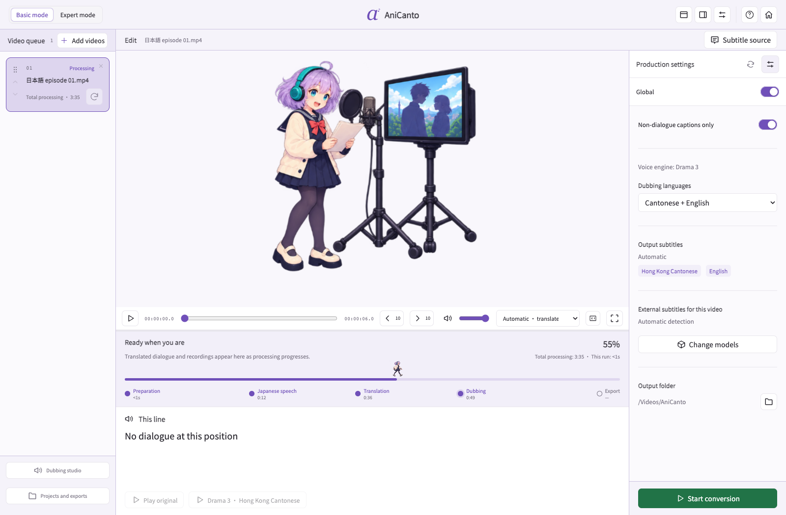
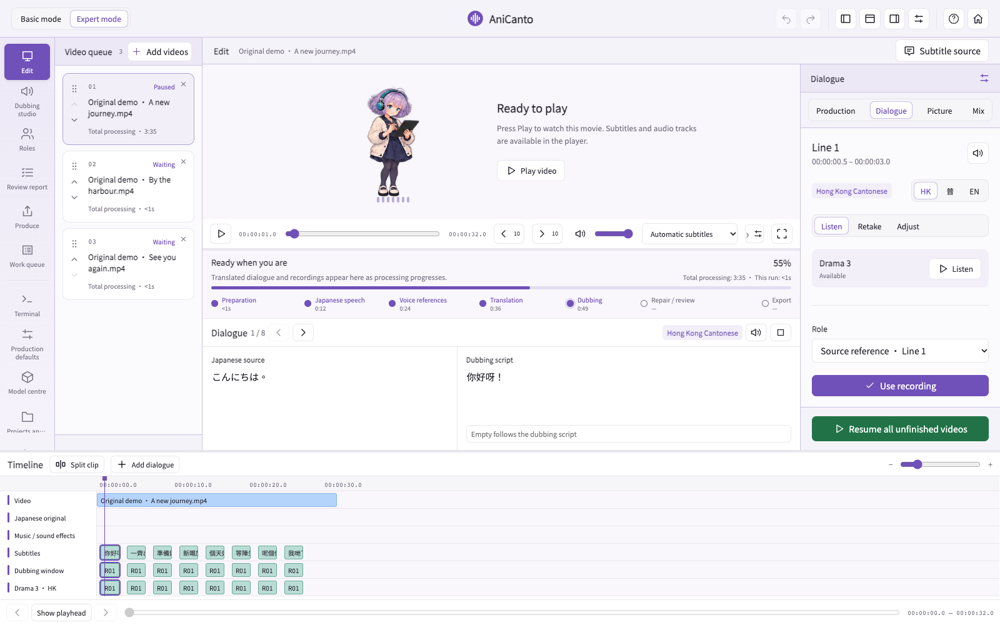
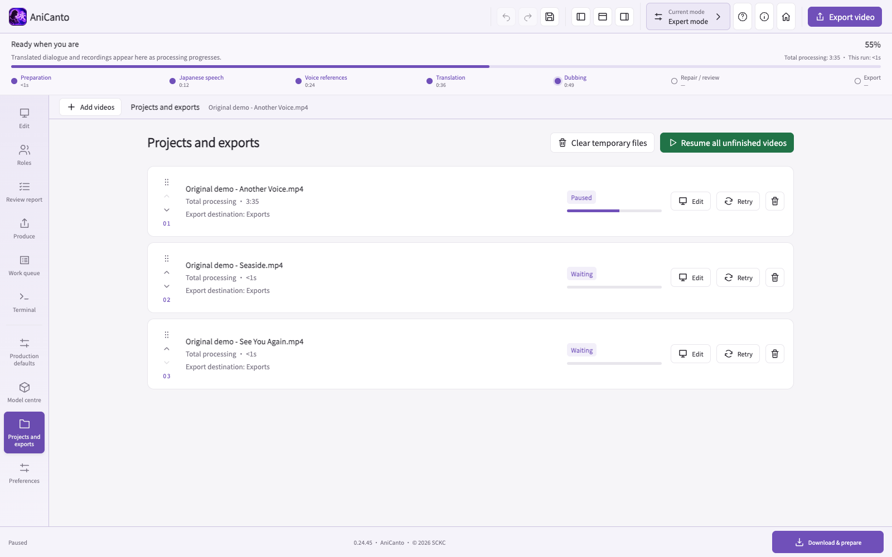
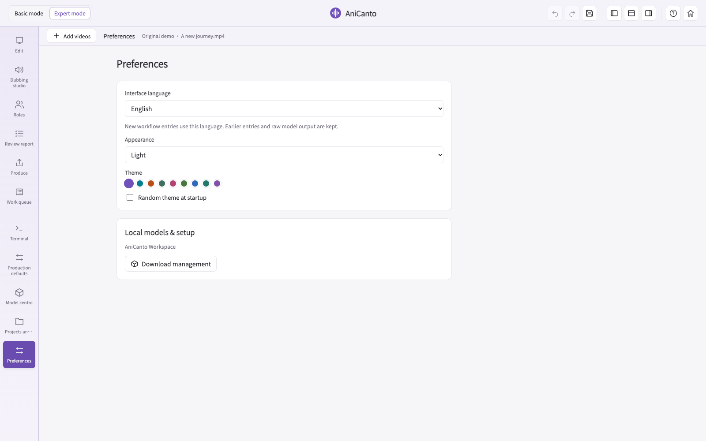

  

# AniCanto

**Your anime. A Cantonese voice.**

Local AI dubbing for Japanese animation — **Hong Kong Cantonese, English, or both in the same video.**

## Why this little project exists

AniCanto 係一個由興趣開始嘅小作品。最初只係希望小朋友可以一邊聽香港廣東話，一邊睇中文字幕，接觸日常口語同學中文字。App 以香港繁體中文為主要設計語言，另設英文介面，方便對廣東話有興趣嘅英語人士使用同參考。希望透過動畫嘅趣味，讓更多人認識香港廣東話嘅表達同文化。

AniCanto started as a hobby project with a simple family wish: helping children hear everyday Hong Kong Cantonese while reading Chinese subtitles and learning Chinese characters. **The app is designed primarily in Hong Kong Traditional Chinese, with an English interface to help English speakers interested in Cantonese use it and follow along.** Through the fun of animation, the project invites more people to discover Cantonese expression and culture.

[Explore the interface](#a-look-inside) · [Formats & subtitle sources](#japanese-dialogue-chinese-subtitles-two-new-voices) · [Models & hardware](#start-with-the-right-voice) · [Workflow](#from-scene-to-speech) · [Limitations](#what-to-expect) · [☕ Support](#support-a-little-more-cantonese)

> **Development preview**
>
> This repository currently introduces the project. Public app downloads and the complete source release are being prepared; they are not available here yet.

## With respect to voice performers

Dubbing is a craft. Character interpretation, emotion, timing, pronunciation and dramatic intent come from people’s training, creativity and dedication.

AniCanto is for personal learning and creative experiments. **It is not intended to replace professional voice actors, and its AI output does not meet the standard of a professional performance.** Please recognise and support the performers behind the voices you love.

## Built by learning from the failures

Japanese animation is a particularly demanding test for AI dubbing: expressive performances, rapid changes of emotion, overlapping voices and cross-language voice imitation can all expose weaknesses in the workflow.

Getting from the first prototype to the current build has taken repeated testing and refinement. Much of that work means watching failed conversions, listening to individual lines, tracing what went wrong and adjusting how the app handles exceptions. A fix is checked against other situations too; improving one scene should not damage another.

**Human judgement remains essential.** AI can flag suspicious recordings and try repairs, but matching a character’s voice, preserving dramatic intent and deciding whether a line sounds natural still need a person to listen. Automatic checks do not prove that a performance is right. AniCanto is an evolving hobby project, and that process of listening, testing and improving continues.

## A new way to hear a familiar scene

The big entrance. The awkward confession. The perfectly timed “Let’s go!” AniCanto lets you explore how a familiar scene feels in Hong Kong Cantonese, with English alongside it when you want a little help following along.

**Curious about Cantonese?** Use the English interface, generate Cantonese and English audio, and compare the subtitle options. Enjoy discovering new expressions while keeping in mind that AI translations and pronunciation can be wrong.

## What makes it different

| Made for animation | A studio to explore |
|---|---|
| **🎵 Keep the opening and ending** Detect OP/ED songs and preserve their original Japanese audio by default. | **🔁 Repair, then listen again** Automatic repair can adapt a line, regenerate a take and check the new recording. |
| **🌏 Cantonese + English dubbing** Generate both languages in one production, with separate Cantonese and English audio tracks in the same exported video and switchable subtitles. | **🎬 Simple start, detailed control** Basic mode for automatic production; Expert mode adds a timeline, line editing and retakes. |
| **🎧 Hear the evidence** Compare the original mix, separated voice and generated recording in the review report when available. | **💻 Run on your own computer** Model inference runs locally after setup. Queue videos, pause, save and resume your work. |

OP/ED detection and repair are automatic attempts, not a guarantee that every song boundary, voice or line will be recognised correctly. The report keeps unfinished work visible.

## A look inside

The app’s primary design language is **Hong Kong Traditional Chinese**. The English interface makes the same workspace accessible to English speakers exploring Cantonese. Screenshots below use that English interface for this project page; the [full gallery](docs/SCREENSHOTS.md) also includes Traditional Chinese views.

Screenshots show the real application interface with original demonstration dialogue and illustrative project/model states. They contain no commercial anime footage and are not conversion benchmarks.

### 01 · Pick your way in

Original assistants and two ways into the same studio, with a choice of Hong Kong Traditional Chinese or English interface text.

### 02 · Start simply

Import your videos, choose a dubbing language and an output folder, then let the workflow proceed.

### 03 · Get close to every line

Browse the timeline, compare source text and the dubbing script, audition a line and keep earlier takes.

### 04 · See what the AI checked

The report shows the source line, translated script, recognised generated speech, timing and repair attempts. Unresolved lines remain labelled.

### 05 · Keep a batch in order

Reorder waiting videos, see each project’s status and resume unfinished work.

<strong>More screenshots</strong>

| Models & setup | Preferences |
|---|---|
|  |  |

[View the complete interface gallery](docs/SCREENSHOTS.md)

## Japanese dialogue, Chinese subtitles, two new voices

**AniCanto supports Cantonese and English bilingual dubbing.** Choose Cantonese, English, or both. With both selected, the exported video contains separate Cantonese and English dubbed audio tracks, alongside the original Japanese track when retained. Switch audio languages in a compatible player; the two dubs do not play over each other.

The translation workflow combines Japanese dialogue with the Chinese subtitle evidence available in your source:

| Input source | How AniCanto uses it |
|---|---|
| **Japanese audio** | Recognises the spoken Japanese and its timing to build the dialogue transcript. |
| **Embedded Chinese text subtitle tracks** | Reads selectable subtitle text stored inside the video container, such as a text track in an MKV or MP4, as supporting evidence for names and meaning. |
| **Burned-in Chinese subtitles — screen OCR** | Reads Chinese captions that are part of the video image. OCR supplies time-matched text evidence; it is distinct from extracting an embedded text track. |
| **External subtitle files** | Can use matching `.srt`, `.ass` or `.vtt` files alongside the video. |

Qwen uses the recognised dialogue and available subtitle evidence to produce **Hong Kong Cantonese and English scripts**; the selected voice engine then generates the dubbed recordings. Subtitles help with context, but missing OCR text should not remove dialogue heard in Japanese. If no readable captions are available, the workflow can continue from Japanese speech recognition.

Automatic subtitle selection checks for a matching external file first, then an embedded text track, then burned-in captions through screen OCR. Expert mode also offers **Japanese audio only** or **Japanese audio + screen OCR** for a newly submitted conversion. OCR quality depends on caption clarity, layout and contrast; embedded subtitle support refers to usable text tracks, not every image-based subtitle format.

For language comparison, choose separate Cantonese and English subtitles, or the combined learning track with **Cantonese on the first line and English underneath**. Audio and subtitle tracks can be selected independently in a compatible player.

### Supported video formats

**MP4 · MKV · MOV · M4V · AVI · WebM · TS**

These are the video container formats accepted by the app. Actual compatibility also depends on the video/audio codecs and file integrity; an accepted extension does not guarantee every encoding will decode. Burned-in captions can be read with OCR, but cannot always be cleanly removed or replaced in the picture.

## Start with the right voice

**For a Hong Kong Cantonese accent, our recommendation is Drama 3 with Qwen 3.5 35B.** In the developer’s listening tests, Drama 3 sounded closest to the Cantonese commonly heard in Hong Kong. Accent and voice resemblance still depend on the reference recording and scene.

| Voice model | What to expect |
|---|---|
| **Drama 3 — recommended** | Closest to a Hong Kong Cantonese accent in current listening tests. |
| **GPT-SoVITS** | May retain a Japanese accent when imitating a Japanese source voice. |
| **CosyVoice 3** | May retain a Japanese accent in this workflow. Offered only with official native weights on Windows NVIDIA/CUDA; unavailable on Mac. |

Qwen translates and helps plan repairs; Drama 3 generates speech. Download choices for text translation are **Qwen 3.5 9B and 35B**. Model versions without confirmed licence evidence have been removed from the download catalogues.

### Recommended Mac

| | Recommendation |
|---|---|
| Computer | **Apple Silicon Mac with 64 GB or more unified memory** |
| System | macOS 14 or later |
| Voice | Drama 3 · 35B · 4-bit MLX |
| Translation | Qwen 3.5 · 35B-A3B · 4-bit MLX |
| Storage | Plan for **100 GB or more free space** for models, environments and working files; long videos need additional room. |
| First setup | Internet access for model and runtime downloads; inference runs locally afterwards. |

Lower-memory presets can differ in accent, voice expression and translation detail. Windows candidates still need real-device startup and GPU testing. Intel Macs are not supported by this Apple Silicon setup.

### Conversion time reference

| Input | Mode | Machine | Models | Approximate processing |
|---|---|---|---|---|
| 25-minute animation | Normal | MacBook Pro M2 Max | Qwen 3.5 35B + Drama 3 | **45 minutes** |

This is a developer-provided reference, not a newly repeated benchmark or a time guarantee. Dialogue density, first-time downloads, video encoding, memory pressure and automatic retakes can change the total substantially.

## From scene to speech

1. **Prepare** — Read the video, audio and subtitle tracks; prepare the project and working files.
2. **Find the dialogue** — Recognise Japanese speech, use available subtitle evidence and detect OP/ED regions.
3. **Prepare source references** — Separate dialogue from background audio and collect reference clips for the chosen voice strategy.
4. **Translate** — Adapt dialogue into Cantonese and/or English while considering meaning and the available speaking window.
5. **Generate and repair** — Generate takes, check language/content/timing, then try targeted rewriting, retakes, reference repair or bounded timing and tempo adjustments when needed.
6. **Review and export** — Mix the selected voices with the background, keep the original track and produce a versioned export with the selected subtitles.

After bounded rewrites, reference repair and gentle timing adjustments with the original voice, a target-language reference may be used as a last resort to recover translated speech. The report identifies this voice change; it is not certified character imitation. Small timing differences can use safe neighbouring gaps, while OP/ED boundaries and other dialogue remain protected; a shot change alone does not require replacing a fitting voice.

Normal mode attempts automatic checks and repair. High-speed mode skips quality review and quality-driven retakes. If a complete dub cannot be verified, a labelled incomplete preview may retain source speech for affected lines; that is not presented as a finished Cantonese dub.

## What to expect

- **Animation first, Japanese first.** The main workflow targets Japanese animated dialogue, not live dubbing or every possible source language.
- **Difficult audio is still difficult.** Overlapping speakers, shouting, whispers, songs, effects and noisy separation can affect recognition, reference quality and completeness.
- **One character, not always one consistent voice.** Normal mode imitates a source reference for each line; it does not lock a character’s identity or timbre across a whole episode. Voice colour, accent and expression can vary between takes.
- **Expressive acting can confuse the AI.** Professional Japanese performers may change timbre dramatically for whispers, shouting, comedy or emotion. When role analysis is used, AI can split the same character into different roles, or merge similar voices. That is a limit of AI recognition, not a flaw in the acting.
- **Automatic repair has limits.** Translation, names, accent, emotion, speaker identity and lip sync can still be wrong. A voice-per-line reference is not proof of a recognised character.
- **No cut-off speech as a shortcut.** The workflow tries shorter wording, full retakes and safe timing changes; small tempo adjustments are bounded. Some lines can remain unresolved.
- **Opening/ending songs stay Japanese by default.** Detection can miss unusual arrangements; inspect the result.
- **Subtitles have boundaries.** Embedded text and speech recognition are useful evidence; burned-in captions cannot be cleanly replaced in every video.
- **Local does not mean lightweight.** Large models need substantial memory, storage and processing time.

[Read the first-run guide](docs/GETTING-STARTED.md) · [Full screenshot gallery](docs/SCREENSHOTS.md)

## Your media, your choices

Use only video, subtitles and voices you have permission to process. AniCanto does not provide anime episodes or grant rights to another person’s voice. Recognition and inference run locally after model setup; setup and updates contact the relevant download hosts.

Original application code is **MIT · © 2026 SCKC**. Third-party tools, models and assets keep their own licences. **Built with Fish Audio** — Drama 3 uses the [Fish Audio Community License](https://huggingface.co/fishaudio/drama-3/blob/main/LICENSE), with separate use, commercial and hosted-service conditions. The MIT application licence does not replace those model terms.

[Licence details](docs/LICENSING.md)

## Support a little more Cantonese

If AniCanto helps you discover a new phrase, enjoy a new voice, or share a little Hong Kong Cantonese with a friend, you can support its continued development. A coffee is optional; curiosity is always welcome.

Made by SCKC · For the fun of hearing Cantonese in a new scene.
