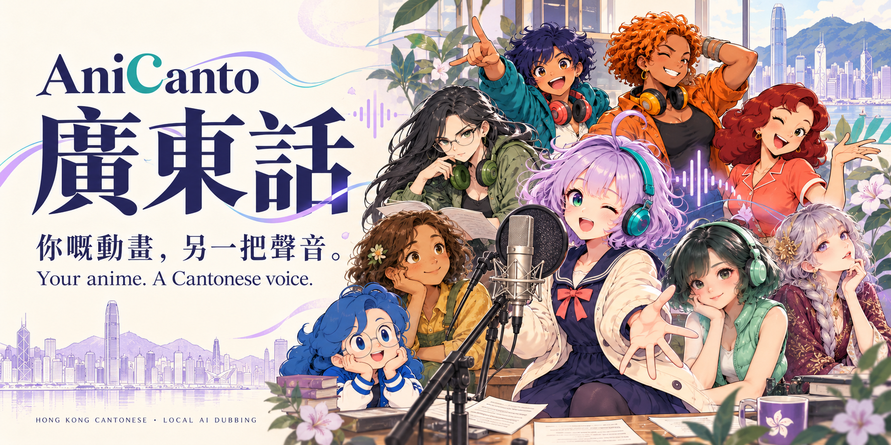

[English](README.md) · [繁體中文](README.zh-HK.md) · **简体中文** · [日本語](README.ja.md)

## 0.25.51 Beta：配音流程更新

更改配音语言会从保存的原文重新翻译，复用原声分析及已验证的声线参考，保留其他音轨及旧成品。翻译重试会参考上次稿件，继续工作不会重置已用次数；香港广东话口语例表也已更新。

# AniCanto

**macOS／Windows · 桌面开源版本**

**你的动画，另一种声音。**

将日本动画的日语对白转换成**香港粤语、普通话或英语配音**。安装所需模型和运行环境后，识别、翻译、配音和导出都在本机完成。

<!-- desktop-downloads:start -->

## 下载

**[Mac 0.25.51](https://github.com/samuelkcc/AniCanto/releases/download/v0.25.51-beta/AniCanto-macOS-0.25.51.zip)** · **[Windows 0.25.51](https://github.com/samuelkcc/AniCanto/releases/download/v0.25.51-beta/AniCanto.exe)**

[版本说明](https://github.com/samuelkcc/AniCanto/releases/tag/v0.25.51-beta) · [对应源码](https://github.com/samuelkcc/AniCanto/releases/download/v0.25.51-beta/available-source-materials.tar.gz) · [源码备份及重建说明](docs/BUILD-AND-RECOVERY.md)
<!-- desktop-downloads:end -->

## 近期更新 · 0.25.51／400

- 影片列表清空后，仍可查看已保存工作和分离音轨。
- 明确勾选后，才清除旧录音、进度和中间影片。
- 保留原片、已登记成品和已安装模型。
- 清理页面可查看完整存储分类，清理进度不会重新归零。
- 更新四语清理指南和开发文件保留规则。

沿用现有截图。Windows 实机操作仍需另行验收。

## 为什么会有 AniCanto

AniCanto 最初只是一个简单的心愿：**希望孩子看动画时，可以听到日常香港粤语，同时跟着中文字幕认识汉字。** 熟悉的故事、角色和对白，可以让接触语言变得更亲切，也让粤语的节奏、语气和幽默延续在日常生活中。

这个由 SCKC 以个人兴趣和学习心态建立的小项目，也希望把这份乐趣分享给更多人。无论是陪孩子接触粤语，还是自己通过粤语、英语和日语对照认识新词句，都可以从熟悉的一个场景开始，慢慢感受香港粤语的表达和文化。

## 尊重专业配音演员

**AniCanto 用于语言学习和创作实验，并非用来取代专业配音演员。** 角色演绎、情绪、节奏和戏剧张力，来自配音演员的训练、创意和投入，不能仅靠生成相似的声音来完成。

AI 可以帮助探索语言和尝试配音，但生成结果仍可能有口音、错字或表演不足，不等同于专业演出。希望大家在使用这个项目的同时，继续欣赏和支持熟悉声音背后的表演者。

## 下载测试原片，听配音成品作比较

点击图片打开输出演示视频，再在播放器选择音轨和字幕。

只需两个3分08秒视频：日文输入原片，以及桌面版输出示范。所有界面语言共用同一组。

- **[日文输入原片 · 尝试转换](https://github.com/samuelkcc/AniCanto/releases/download/demo-v19/AniCanto-demo-input.mp4)**
- **[桌面版输出示范 · 试听比较](https://github.com/samuelkcc/AniCanto/releases/download/demo-v19/AniCanto-demo-output.mp4)**

输出视频包含 **粤语、普通话、英文、日文四条音轨**。两个视频均内嵌 **繁体中文、简体中文、英文、日文字幕**，可在支持的播放器中切换。

示范视频由桌面版配合 Fish Audio Drama3 制作，原稿经 Qwen3.6-35B-A3B 4-bit MLX 校对，是经过编排的比较示范，并非未经编辑的一键转换结果。Built with Fish Audio.

[测试视频详情](docs/zh-CN/DEMO.md)

## 先选择电脑配置

**首选配音模型：完整 Drama 3。** 翻译搭配 Qwen 3.5：64 GB Mac 建议使用 35B；32 GB RAM 的 Windows 可搭配 9B。开发者试听中，Drama 3 更接近香港粤语发音；实际效果仍受原声和场景影响。

| 平台 | 建议系统及内存 | Drama 3 运行方式 |
| --- | --- | --- |
| **Mac** | Apple Silicon、macOS 14+；建议 **64 GB 或以上统一内存** | 完整 4-bit MLX，使用 Apple Silicon GPU／统一内存；估算约 28 GB |
| **Windows** | Windows 10／11 x64；**32 GB RAM 起，64 GB 更充裕** | 完整 GGUF Q2：兼容 NVIDIA 可选 **CUDA 加速**；AMD／Intel／集成显卡使用 CPU，仍需系统 RAM。 |

**Windows 完整 Drama 3 Q2 已加入 NVIDIA CUDA 加速选项。** 在模型部署选择 **Drama 3 处理方式 → 自动**，或者 **NVIDIA · CUDA**；自动模式按设备、内存及部署检查决定能否使用 CUDA。AMD、Intel 或集成显卡请选择 CPU。App 分别显示系统 RAM 和 VRAM，并下载相应加速程序及库；沿用同一份 Q2 权重，无需重复下载模型。需要兼容的 NVIDIA 驱动。

作者初步 Windows 实测，CUDA 的 Drama 3 生成速度明显改善；没有固定加速倍数，也不代表所有显卡均已测试。**部分识别和校对阶段仍使用 CPU，并非整个流程全部 GPU 加速。**

32 GB Mac 可以尝试较小的翻译模型组合，但 Drama 3 可能导致交换内存、明显变慢或加载失败。以上内存数字为规划估算。两个平台建议预留 **100 GB 以上**存储空间用于模型、运行环境和工作文件；长视频需要更多。

其他配音选项包括 **GPT-SoVITS V2 Pro Plus、GPT-SoVITS V4 和 CosyVoice 3**，取决于平台和运行环境支持。它们是可选的替代模型，无需全部下载；不同引擎的口音、表现力和声线相似度可能不同。

### 作者反复试听后的选择

经过逐段反复比较，**完整 Drama 3 是目前 AniCanto 试过的模型中，香港粤语口音最符合作者预期的选择**。其他 TTS 模仿日语角色声线时，能保留角色感和表现力，但有时也会把日语式发音或语调带入粤语。这是个人试听心得，并非独立评测，也不保证每个角色都能达到同样效果；Drama 3 仍可能读错字、表现力不足或需要重新生成。

### 作者测试平台与使用预期

作者的测试设备是 **MacBook Pro M2 Max、64 GB 统一内存**，以及一台配备 **NVIDIA 独立显卡（16 GB VRAM）、32 GB 系统 RAM 的 Windows 笔记本**。版本发布的验证标准是在两台设备完成从导入到输出的转换；个别版本尚未完成的平台测试会在发布说明列出。Windows 最新 NVIDIA CUDA 更新已通过作者初步桌面测试，生成速度明显改善；结果只代表已测试配置和工作内容，仍欢迎其他配置反馈。两台设备的测试结果，并不代表所有硬件组合都已验证。

**作者使用 M2 Max 与完整 Drama 3 的实测参考，视频长度与转换时间约为 1:2**：30 分钟视频约需 60 分钟，其中已包含约 8–10% 对白的 AI 自动修复。这是作者测试素材的经验值，并非速度保证，也不能视为 Windows 的耗时估算。场景复杂程度、模型设置、修复次数、存储速度与内存压力都会影响总时间。

以上时间例子使用较早的修复流程；0.25.0默认关闭额外核对，并非新版速度保证。

如果其他配置出现兼容性问题，欢迎[反馈问题](https://github.com/samuelkcc/AniCanto/issues)，附上应用版本、操作系统、CPU、RAM、显卡／VRAM、所选模型及停滞或变慢的阶段。可附上移除私人信息后的诊断日志，无需公开私人视频或录音。

## 应用可以做什么

| 功能 | 如何使用 |
| --- | --- |
| **粤语／普通话／英语配音** | 选择单语、双语或三语组合，在同一视频中保留独立音轨及字幕，通过兼容播放器切换。 |
| **中文字幕辅助核对** | 默认以已选且可读的内置／外挂字幕提供意思，语音识别辅助对时；没有文字字幕时，自动流程使用语音优先；烧录字幕需另选语音／OCR。 |
| **保留片头片尾** | 自动检测 OP／ED，默认保留日语歌曲和原声。 |
| **基本及专家模式** | 基本模式自动处理；专家模式提供时间轴、改稿、时间调整及逐句编辑。 |
| **试听、重录和校对** | 比较原声、分离声音和生成配音；逐句重录或选择旧录音，再导出新版，保留之前的成品。 |
| **本机批量处理** | 视频排队、调整未开始视频的顺序、暂停保存和继续；模型准备好后可离线运行。 |
| **模型与下载管理** | 查看已安装模型、剩余下载量和预计内存需求；切换前可检查或修复文件。 |
| **保存项目与版本** | 保留台词、录音和校对记录；导出另一版本，不覆盖之前的成品。 |
| **独立配音器** | 文字或录音转成可修改的广东话稿，保存录音版本、双文对照学习和导出 WAV。 |

### 新增：视频普通话配音

在 **制作设置 → 配音语言** 选择 **普通话**，可单独使用，或与香港粤语、英语组合，也可以同时生成三种语言。普通话使用独立稿件和录音，采用中国大陆口语及简体字幕；可按选择保留原声，再通过兼容播放器切换音轨。

适用于基本模式和专家模式的视频流程。切换界面语言不会自动新增配音音轨。**独立配音器目前仍输出粤语**；现有下载示范视频保留粤语／英语／日语。

### 配音器：从文字或录音，制作自己的片段

**基本模式和专家模式均可使用**，无需先导入影片。输入日语、英语，或者录音／导入自己的说话；录音会自动识别来源语言，实际支持范围取决于已安装模型。

1. **核稿及翻译**：先修正识别原稿，选择本机翻译模型，再修改广东话译稿。
2. **生成及试听**：选择已安装配音引擎、模板参考，或在支持时使用自己录制的声线，调整语速及实际支持的生成参数。模仿声线需要完整清晰的 3–10 秒参考。
3. **保存及比较**：不同版本放在独立「配音器」播放器分类。可对照原声／配音和两份文字、调播放速度、循环段落、改名、导出 WAV 或只删除某个版本；分类显示名称跟随界面语言。

生成后独立复听会标记字句及语言疑点；可选自动修复只对确认有问题的部分额外重试，每段最多两次，不会仅因同音字差异就换声。有疑点的版本可由你听过并明确接受后保存，旧版本会保留。

### AI 自动修复流程

标准流程保留首轮有声录音，额外内容核对默认0次。

1. **首次翻译**：粤语、普通话及英语都参考原声时长，以软长度提示保留完整意思。
2. **必要补录**：每句最多共3次生成，包括首次模仿和最多一次同引擎通用声线补录；先保存次数，续跑不重置。有声录音不会为了用满次数而重录。
3. **专家额外选项**：内容核对、自动内容修复、原声时长限制、超过2秒的有声重叠修正分别控制。静音不计重叠；失败的额外版本不会替换首轮。

默认允许对话重叠，保留完整录音和原声起点；尾句需要时延长最后画面。暂停的旧任务保留冻结流程。

Apple Silicon 可选 **MLX Whisper** 加速复听（模型约 3.1 GB）；每句完成即时保存并复用，超时保留已完成部分。同一批 102 句测试：CPU 约 18 分 16 秒，MLX 约 2 分 45 秒。这只代表复听阶段速度，识别结果仍可能不同。

[检查及修复详情](docs/INDEPENDENT-LISTENING.md)

### 实验功能：其他来源语言

除日语动画外，检测到其他来源语言时，应用也会在所选引擎支持的情况下尝试转换为粤语。**这个功能不保证成功；目前只针对英语转粤语进行过有限测试和部分优化。** 其他语言、视频类型和声线效果尚未全面验证。

## 字幕来源与语言音轨

语音负责配音开始与结束时间。专家模式可在「制作设置 → 字幕与来源」选择内容流程。

| 流程 | 翻译与校对来源 |
| --- | --- |
| **自动检测** | 有可读内置或外挂字幕时使用字幕优先，否则使用语音优先。 |
| **字幕优先** | 翻译所选字幕，以原声定位配音时间。 |
| **语音优先** | 翻译语音，再用同一句的可用字幕校对配音稿。 |
| **语音／OCR** | 语音配合 OCR 字幕，不使用内置或外挂字幕。 |

粤语与普通话输出优先选中文字幕，繁简皆可。英语输出优先选英文字幕，没有英文时可用中文。字幕语言不确定时会询问；接受原声语言不等于接受不确定的字幕选择。

在「字幕来源 → 导入字幕文件」加入 SRT、ASS、SSA 或 VTT。播放器的字幕选择只影响预览；原装字幕时间与配音时间分开保留。

「仅配对白」默认关闭。开启后，字幕意思与独立语音识别明显不符时可排除配音。没有识别结果或结果不确定，不等于确认原声错误；此功能不授权重录。

可按选择保留原声，加入粤语、普通话或英语音轨，并通过兼容播放器切换。

## 支持格式

| 类别 | 格式 |
| --- | --- |
| **输入视频** | MP4 · MKV · MOV · M4V · AVI · WebM · TS |
| **外挂字幕** | SRT · ASS · SSA · VTT |
| **输出成品** | MP4，按所选设置加入音轨和字幕。 |
| **配音器音频** | 导入 WAV · MP3 · M4A · FLAC · WebM · OGG；导出 WAV。 |

扩展名兼容仍需文件内的影音编码可以读取。画面内嵌字幕可尝试 OCR，但不保证能从画面中干净移除。

## 从视频到另一种声音

1. **导入与准备**：添加视频列表，读取音频和字幕，准备所需模型。
2. **识别与翻译**：识别原声、整理分离对白参考，再结合可用字幕生成所选粤语、普通话和／或英语稿。
3. **生成与检查**：制作配音，保留检测到的 OP／ED 原声，必要时进行有限次局部修复。
4. **导出与校对**：将所选音轨放入新 MP4；需要改善个别句子时，再打开校对报告试听。

### 不必从头开始，逐段改善一幕

| 想修改什么 | 在哪里操作 |
| --- | --- |
| 听清楚差别 | 在 **校对报告** 比较原装混音、分离对白和已保存配音。 |
| 修正一句 | 在 **专家模式** 修改台词或设置，生成新录音，试听后再导出。 |
| 使用之前的录音 | 在 **校对报告** 选择保留录音，再应用选择导出新版。 |
| 更改制作或语言音轨 | 通过 **制作预设／制作导出** 创建新版本，沿用仍适用的项目资料。 |
| 稍后再检查 | 将校对项标记为已检查或稍后处理，证据仍会保留。 |

旧录音和之前的成品会保留。新增语言、更改模型或台词仍可能需要重新翻译或生成配音；复用项目并不意味着所有更改都能立即完成。

## 三步开始

1. 下载并打开应用，准备模型和运行环境；首次设置需要网络。
2. 添加视频，选择粤语、普通话、英语或组合。外挂字幕入口：预览上方 **字幕来源 → 导入字幕文件**（SRT／ASS／SSA／VTT）。
3. 开始处理并播放成品。如有疑问，在校对报告中逐句比较原声、分离声音和配音，重新生成或选择旧录音，再导出另一个版本。

[字幕导入说明](docs/zh-CN/GETTING-STARTED.md)

## 新版界面

以下是 **0.25.44／304** 的实际 Mac 界面，于 2026 年 11 月 2 日使用独立原创示范文件截取。预览关闭，助手保留五官。图片展示操作界面，不代表转换成果或 Windows 实机验证。

### 欢迎页

### 基础模式 · 分组制作设置

### 专家模式 · 时间轴与制作设置

### 专家模式 · 额外 AI 修复

[查看新版界面图集](docs/zh-CN/SCREENSHOTS.md)

## 从失败片段中不断改进

AniCanto 的许多改进，来自逐句回听失败转换、比较录音，再改善难处理的场景。动画对 AI 配音尤其有挑战：低语、喊叫、多人重叠、音乐和夸张表演都会影响识别与声线参考。修好一幕，也要检查是否影响其他场景。

一般模式逐句准备原声参考，**不保证同一角色整集都保持完全相同的音色**。完整 AI 校对提供角色分析和参考整理，但身份仍可能识别错误。自动检查能帮助寻找问题，表演是否自然，最后仍需人工试听判断。

<strong>存在校对疑点，是否代表整部视频无法使用？</strong>

已保存的成品仍可播放。报告指出可能需要注意的句子，方便比较和选择。备用处理可能按设置使用另一种声音或原声；成功导出不代表每一句都已正确配成粤语。

<strong>为什么转换有时需要很久？</strong>

对白密度、模型加载、内存压力、音频分离和重录次数都会影响时间。兼容 Windows 可用 NVIDIA CUDA 加速 Drama 3；CPU 选项较慢，部分识别／校对仍使用 CPU。有空闲 RAM 不代表推理自然更快，不同视频没有固定完成时间保证。

<strong>视频需要上传云端吗？</strong>

此流程无需云端翻译或配音服务。模型与运行环境就绪后，识别、翻译、配音和导出均在本机完成；首次下载、修复下载和更新需要联网。

## 使用前须知

AI仍可能出现口音、错译、漏字或声线变化，重要场景需要试听。默认以已选且可读的内置／外挂字幕提供意思，语音识别辅助对时；没有可用字幕时，自动流程使用语音优先；语音／OCR 是独立选择。支持原声、粤语、普通话、英语独立音轨及OP／ED保留，效果因场景而异。

SCKC 的兴趣项目。原创代码采用 MIT，第三方组件和模型保留各自许可。Built with Fish Audio；Drama 3 使用 Fish Audio Community License 1.0。请只处理有权使用的视频、字幕和声音。

## 让更多人认识粤语

如果 AniCanto 帮你与孩子分享一句粤语、认识一个新词，或用另一种声音重温熟悉的一幕，欢迎支持这个独立小项目继续成长。请喝咖啡完全自愿，是鼓励更多试听、测试和开发的一种方式；用心的问题反馈和使用建议同样珍贵。

**SCKC 制作**——让熟悉的故事，再用粤语讲一次。

[MIT](LICENSE) · [授权详情](docs/zh-CN/LICENSING.md)

