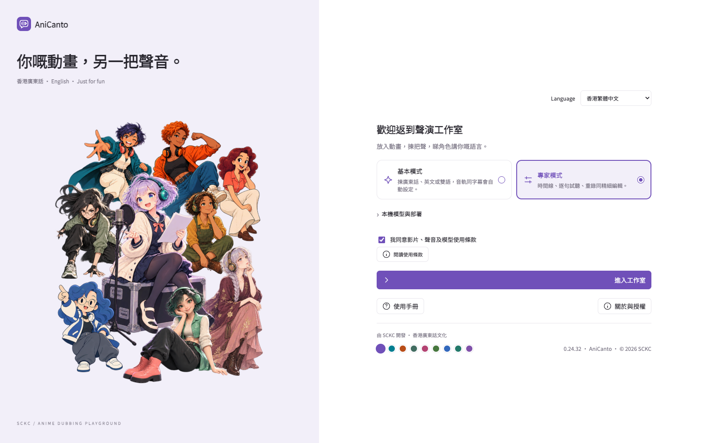
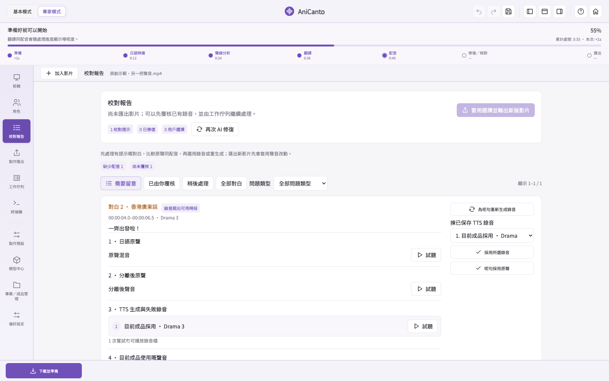

[English](README.md) · **繁體中文** · [简体中文](README.zh-CN.md) · [日本語](README.ja.md)

# AniCanto

**你嘅動畫，另一把聲音。**

將日本動畫嘅日文對白轉成**香港廣東話、普通話或英文配音**。模型同執行環境準備好後，辨識、翻譯、配音及匯出都喺本機完成。

[下載](#下載-beta--02468) · [功能](#app-可以做啲乜) · [處理流程](#由影片到另一把聲音) · [介面圖](#新版介面) · [技術支援](SUPPORT.zh-HK.md) · [支持計劃](#支持更多人認識廣東話) · [iPad 私隱政策](docs/IPAD-PRIVACY-POLICY.zh-HK.md)

## 點解會有 AniCanto

AniCanto 最初只係一個簡單嘅心願：**希望小朋友睇動畫時，可以聽到日常香港廣東話，同時跟住中文字幕認識漢字。** 熟悉嘅故事、角色同對白，可以令接觸語言變得親切一點，亦讓廣東話嘅節奏、語氣同幽默喺生活入面延續落去。

呢個由 SCKC 以個人興趣同學習心態建立嘅小作品，亦希望將呢份樂趣分享俾更多人。無論係陪小朋友接觸廣東話，定係自己想透過廣東話、英文同日文對照認識新詞句，都可以由熟悉嘅一幕開始，慢慢感受香港廣東話嘅表達同文化。

## 尊重專業配音員

**AniCanto 以語言學習同創作實驗為本，並唔係用嚟取代專業配音員。** 角色演繹、情緒、節奏同戲劇張力，都來自配音員嘅訓練、創意同投入，唔係單靠生成一把相似嘅聲音就可以做到。

AI 可以協助探索語言同試做配音，但生成結果仍可能有口音、錯字或演繹不足，唔等同專業演出。希望大家享受呢個小作品之餘，繼續欣賞同支持熟悉聲音背後嘅表演者。

## 下載 Beta · 0.24.68

**[下載 Mac](https://github.com/samuelkcc/AniCanto/releases/download/v0.24.68-beta/AniCanto-macOS-0.24.68.zip)** · **[下載 Windows](https://github.com/samuelkcc/AniCanto/releases/download/v0.24.68-beta/AniCanto.exe)** · [更新內容及對應源碼](https://github.com/samuelkcc/AniCanto/releases/tag/v0.24.68-beta)

[下載對應源碼及第三方來源包](https://github.com/samuelkcc/AniCanto/releases/download/v0.24.68-beta/available-source-materials.tar.gz) · [源碼備份及重建說明](docs/BUILD-AND-RECOVERY.md)

## 今個 Beta 新增咗乜

- **高速模式亦保留原聲表演：**笑聲、喊聲及呼吸嘅額外保護繼續啟用，唔會因此增加品質重錄；修正 Windows 分類名稱映射。
- **保留原有交付取樣率：**補返原聲表演時，唔再將 Drama 3／GPT V4 混音強制降到 24 kHz；分類證據跨音軌沿用。
- **修復流程有共同規格：**保留第一輪有聲錄音，只自動補無聲／損壞；實際偏長仍可有限改短。列明 Mac／Windows 差異及 iPad 待同步驗收。

## 先睇電腦配置

**首選配音模型：完整 Drama 3。** 翻譯配搭 Qwen 3.5：64 GB Mac 建議 35B；Windows 32 GB RAM 可配 9B。Drama 3 喺開發者試聽中較接近香港廣東話，實際效果仍受原聲同片段影響。

| 平台 | 建議系統及記憶體 | Drama 3 執行方式 |
| --- | --- | --- |
| **Mac** | Apple Silicon、macOS 14+；**64 GB 或以上統一記憶體**建議 | 完整 4-bit MLX，使用 Apple Silicon GPU／統一記憶體；估算約 28 GB |
| **Windows** | Windows 10／11 x64；**32 GB RAM 起，64 GB 較充裕** | 完整 GGUF Q2：兼容 NVIDIA 可選 **CUDA 加速**；AMD／Intel／內置顯示晶片用 CPU，仍需要系統 RAM。 |

**Windows 完整 Drama 3 Q2 已加入 NVIDIA CUDA 加速選項。** 喺模型部署揀 **Drama 3 處理方式 → 自動**，或者 **NVIDIA · CUDA**；自動模式會按裝置、記憶體及部署檢查決定能否使用 CUDA。AMD、Intel 或內置顯示晶片請用 CPU。App 會分開顯示系統 RAM 同 VRAM，並下載相應加速程式及函式庫；沿用同一份 Q2 權重，唔使重複下載模型。需要兼容嘅 NVIDIA 驅動。

作者初步 Windows 實測，CUDA 嘅 Drama 3 生成速度明顯改善；未有固定加速倍數，亦唔代表所有顯示卡都已測試。**部分辨識同校對階段仍使用 CPU，唔係整個流程全部 GPU 加速。**

32 GB Mac 可以嘗試較小嘅翻譯模型組合，但 Drama 3 可能令系統用交換空間、明顯變慢或載入失敗。上述數字係規劃估算。兩個平台建議預留 **100 GB 以上**作模型、執行環境及工作檔；長片要更多。

其他配音選項包括 **GPT-SoVITS V2 Pro Plus、GPT-SoVITS V4 同 CosyVoice 3**，視乎平台及執行環境支援。佢哋係可選擇嘅替代模型，唔需要全部下載；唔同引擎嘅口音、表情同聲線相似度可能有差異。

### 作者反覆試聽嘅選擇

作者逐段反覆比較後，**完整 Drama 3 係目前 AniCanto 試過嘅模型之中，香港廣東話口音最合乎預期嘅選擇**。其他 TTS 模仿日語角色聲線時，可以保留角色感同表情，但有時亦會將日語式發音或語調帶入廣東話。呢個係個人試聽心得，並非獨立評測，亦唔代表每個角色都有同樣效果；Drama 3 仍可能讀錯字、表情不足，或者需要重新生成。

### 作者測試平台與使用預期

作者使用 **MacBook Pro M2 Max、64 GB 統一記憶體**，以及一部配備 **NVIDIA 獨立顯示卡（16 GB VRAM）、32 GB 系統 RAM 嘅 Windows 筆電**測試。版本發佈嘅驗證標準，係喺兩部機完成由匯入到輸出嘅轉換；個別版本仍待完成嘅平台測試會喺發佈說明列出。Windows 最新 NVIDIA CUDA 更新已通過作者初步桌面測試，生成速度明顯改善；結果只代表已測配置同工作內容，仍歡迎其他配置回報。兩部測試機嘅結果，唔代表所有硬件組合都已驗證。

**作者用 M2 Max 配完整 Drama 3 嘅實測參考，影片長度與轉換時間約為 1:2**：30 分鐘影片約需 60 分鐘，當中已包括約 8–10% 對白嘅 AI 自動修復。呢個係作者測試片段嘅經驗值，唔係保證速度，亦唔可以當成 Windows 嘅時間估算。片段複雜程度、模型設定、修復次數、儲存速度同記憶體壓力，都會影響總時間。

如果其他配置遇到相容性問題，歡迎[回報問題](https://github.com/samuelkcc/AniCanto/issues)，附上 App 版本、作業系統、CPU、RAM、顯示卡／VRAM、所選模型，同停滯或變慢嘅階段。可以附上移除私人資料後嘅診斷記錄，唔需要公開私人影片或錄音。

## App 可以做啲乜

| 功能 | 可以點用 |
| --- | --- |
| **廣東話／英文配音** | 可揀單語或雙語，同一條影片保留獨立音軌及字幕，喺相容播放器切換。 |
| **用中文字幕輔助核對** | 參考內置文字字幕、外掛字幕或畫面 OCR，幫助理解意思同人名；日文聲音仍係主要依據。 |
| **保留片頭片尾** | 自動偵測 OP／ED，預設保留日文歌曲及原聲。 |
| **基本及專家模式** | 基本模式自動處理；專家模式提供時間軸、改稿、時間調整及逐句編輯。 |
| **試聽、重錄及校對** | 比較原聲、分離聲音同生成配音；逐句重錄或揀舊錄音，再匯出新版，保留先前成品。 |
| **本機批次處理** | 排隊轉片、調整未開始影片次序、暫停保存同續做；模型準備好後可離線處理。 |
| **模型及下載管理** | 查看已安裝模型、尚需下載量及估算記憶體需要；切換前可檢查或修復檔案。 |
| **保存專案及版本** | 保留台詞、錄音同校對紀錄；匯出另一個版本，唔會覆蓋先前成品。 |
| **獨立配音器** | 文字或錄音轉成可改稿廣東話，保存錄音版本、雙文對照學習同匯出 WAV。 |

### 新增：影片普通話配音

喺 **製作設定 → 配音語言** 揀 **普通話**，可以單獨使用，或者配搭香港廣東話、英文，亦可以三種一齊生成。普通話有獨立稿件同錄音，使用中國大陸口語及簡體字幕；可按選擇保留原聲，再喺相容播放器切換音軌。

基本模式同專家模式嘅影片流程都適用。切換介面語言唔會自動新增配音音軌。**獨立配音器目前仍輸出廣東話**；現有下載示範影片保留廣東話／英文／日文。

### 配音器：由文字或錄音，製作自己嘅片段

**基本模式同專家模式都可以用**，毋須先匯入影片。可以打日文、英文，或者錄音／匯入自己嘅說話；錄音會自動辨識來源語言，實際支援範圍視乎已安裝模型。

1. **核稿及翻譯**：先修正辨識原稿，揀本機翻譯模型，再修改廣東話譯稿。
2. **生成及試聽**：揀已安裝配音引擎、範本參考，或支援情況下用自己錄低嘅聲線，調整語速及實際支援嘅生成參數。模仿聲線需要完整、清晰嘅 3–10 秒參考。
3. **保存及比較**：不同錄音版本放喺獨立「配音器」播放器分類。可對照原聲／配音同兩份文字、調播放速度、循環段落、改名、匯出 WAV，或者只刪某個版本；分類顯示名會跟介面語言切換。

生成後獨立覆聽會標示字句同語言疑點；可選自動修復只對確認有問題嘅部分額外重試，逐段最多兩次，唔會因單純同音字差異就換聲。有疑點版本可由你聽過並明確接受後保存，舊版本會保留。

### AI 自動修復流程

一般模式而家優先保留首輪有聲錄音：

1. **保留**：有聲錄音照用；語言、口音同漏句疑點只留覆核提示。
2. **補聲**：無聲或損壞自動補，最多兩次額外嘗試；實際超時嘅對白仍會局部保留意思改短，新錄音適合時段先採用；唔因語言疑點重錄。
3. **按需要校對**：逐句試聽、揀已保存錄音或手動重錄；偏好設定仍可明確揀詳細自動檢查。

Apple Silicon 可選 **MLX Whisper** 加速覆聽（模型約 3.1 GB）；每句完成即保存及沿用，超時唔會白做已完成部分。同一批 102 句測試：CPU 約 18 分 16 秒，MLX 約 2 分 45 秒。呢個只係覆聽階段速度，辨識結果仍可能不同。

[檢查及修復詳情](docs/INDEPENDENT-LISTENING.md)

### 實驗功能：其他來源語言

除咗日文動畫，如果偵測到其他來源語言，App 亦會喺所選引擎支援嘅情況下，嘗試轉成廣東話。**呢個功能唔保證成功；目前只針對英文轉廣東話做過有限測試同部分優化。** 其他語言、影片類型及聲線效果仍未全面驗證。

## 字幕來源同語言音軌，分清楚就容易用

AniCanto 以**實際講出嚟嘅對白為主**，字幕協助核對意思同人名。中文字幕係參考，唔代表一定逐字照讀。

| 來源或輸出 | App 會點處理 |
| --- | --- |
| **外掛字幕檔** | 喺 **字幕來源 → 匯入字幕檔**，為所選影片配對 SRT、ASS、SSA 或 VTT。 |
| **影片內置文字字幕** | 讀取 MKV、MP4 等容器入面可用嘅文字字幕軌。 |
| **燒入畫面嘅中文字幕** | 冇可讀文字軌時嘗試 OCR；清晰度同排版會影響辨識。 |
| **原聲、廣東話、普通話及英文音軌** | 按選擇保留原聲，加入所選配音語言，另可揀獨立字幕或雙語學習字幕，再喺相容播放器切換。 |

自動選擇會先找配對外掛字幕，再找內置文字軌，最後嘗試畫面 OCR。**原裝字幕時間同配音時間分開保存**；更改介面語言唔會改變成品嘅配音語言。

## 支援格式

| 類別 | 格式 |
| --- | --- |
| **輸入影片** | MP4 · MKV · MOV · M4V · AVI · WebM · TS |
| **外掛字幕** | SRT · ASS · SSA · VTT |
| **輸出成品** | MP4，按所選設定加入音軌及字幕。 |
| **配音器音訊** | 匯入 WAV · MP3 · M4A · FLAC · WebM · OGG；匯出 WAV。 |

影片副檔名相容，仍需檔案內嘅影音編碼可以讀取；燒入畫面嘅字幕可嘗試 OCR，唔代表一定可以乾淨移除。

## 由影片到另一把聲音

1. **匯入及準備**：加入影片清單，讀取聲音同字幕，準備所需模型。
2. **辨識及翻譯**：聽原聲、整理分離對白參考，再配合可用字幕，建立所選廣東話、普通話及／或英文稿。
3. **生成及檢查**：製作配音，保留偵測到嘅 OP／ED 原聲；有需要就作有限次局部修復。
4. **匯出及校對**：將所選音軌放入新 MP4；想改善個別句子時，再打開校對報告細聽。

### 唔使由頭再嚟，逐段改好一幕

| 想改啲乜 | 去邊度做 |
| --- | --- |
| 聽清楚有乜分別 | 喺 **校對報告** 比較原裝混音、分離對白同已保存配音。 |
| 修正其中一句 | 喺 **專家模式** 改台詞或設定，生成新錄音，先試聽再決定匯出。 |
| 用返之前嗰條聲 | 喺 **校對報告** 揀保留錄音，再套用選擇匯出新版。 |
| 更改製作或語言音軌 | 透過 **製作預設／製作匯出** 建立新版本，沿用仍適用嘅專案資料。 |
| 留待之後先檢查 | 將校對項目標記為已檢查或稍後處理，證據繼續保留。 |

舊錄音同先前成品會保留。新增語言、更改模型或台詞，仍可能要再翻譯或生成配音；沿用專案唔代表所有更改都即時完成。

## 三步開始

1. 下載並開啟 App，完成模型同執行環境準備；首次設定需要網絡。
2. 加入影片，揀廣東話、普通話、英文或組合。要用外掛字幕：預覽上方 **字幕來源 → 匯入字幕檔**（SRT／ASS／SSA／VTT）。
3. 開始處理；完成後播放成品。有疑點可打開校對報告，逐句聽原聲、分離聲音同配音，再重錄或改揀錄音，輸出另一個版本。

[字幕匯入說明](docs/zh-HK/GETTING-STARTED.md)

## 下載測試原片，聽返配音成品比較

只需兩條三分鐘影片：日文輸入原片，同桌面版輸出示範。所有介面語言共用同一組。

- **[日文輸入原片 · 試吓轉換](https://github.com/samuelkcc/AniCanto/releases/download/demo-v15/AniCanto-demo-input.mp4)**
- **[桌面版輸出示範 · 試聽比較](https://github.com/samuelkcc/AniCanto/releases/download/demo-v15/AniCanto-demo-output.mp4)**

輸出片包含 **廣東話、普通話、英文、日文四條聲道**。兩條片都內嵌 **繁體中文、簡體中文、英文、日文字幕**，可喺支援嘅播放器切換。

示範片由桌面版配合 Fish Audio Drama3 製作，稿件經 Qwen3.6-35B-A3B 4-bit MLX 校對，係經編排嘅比較示範，並非 iPad App 自動轉換成果。Built with Fish Audio.

[測試影片詳情](docs/zh-HK/DEMO.md)

## 新版介面

以下係 0.24.63 真實介面。剪輯畫面統一用淺紫色主題，**關閉影片預覽，顯示動畫小助手**；模型及專案狀態只作示範，唔係轉換效能測試。

### 歡迎及部署

揀介面語言，準備本機模型，再選基本或專家模式入工作室。

### 基本模式：進度及試聽

加入影片、揀配音語言同輸出資料夾，再跟進處理及逐句試聽；預覽可以保持關閉，由小助手陪住你。

### 專家模式：時間軸及逐句編輯

用橫跨底部嘅時間軸比較原聲對白同配音稿、調整時間，亦可以為所選一句即時生成另一條錄音。

### 校對報告：疑點及錄音比較

睇返標示咗啲乜、試過點修復，再比較保留錄音。揀好之後匯出另一個版本，原有成品繼續保留。

### 配音器與已保存片段

核對原稿同廣東話譯稿，再生成及保存不同錄音；播放器可對照原聲、配音同兩份文字。

### Windows：NVIDIA CUDA 部署

可揀自動偵測、NVIDIA CUDA 或 CPU，分開顯示系統 RAM、VRAM 同額外 CUDA 下載；圖片展示部署選項，唔係速度測試成績。

[查看全部介面截圖](docs/zh-HK/SCREENSHOTS.md)

## 由失敗片段一路學返嚟

AniCanto 嘅改進，好多都來自逐句聽返失敗轉換、比較錄音，再修正難處理嘅場景。動畫對 AI 配音特別有挑戰：低語、叫喊、多人搭聲、音樂同誇張演繹，都會影響辨識同聲線參考。修好一幕，亦要檢查會唔會影響另一幕。

一般模式按每句原聲準備參考，**唔保證同一角色全集都係完全相同嘅音色**。完整 AI 校對提供角色分析同參考整理，但身份仍可能認錯。自動檢查可以幫手找問題，演繹自然唔自然，最後仍然要靠人去聽。

<strong>有校對疑點，係咪代表成條片唔用得？</strong>

已保存成品仍然可以播放。報告會指出可能需要留意嘅句子，方便比較同選擇。後備處理可能按設定使用另一把聲或原聲；成功匯出唔等於每一句都已正確配成廣東話。

<strong>點解有時轉換需要好耐？</strong>

對白密度、模型載入、記憶體壓力、聲音分離同重錄次數都會影響時間。兼容 Windows 可用 NVIDIA CUDA 加速 Drama 3；CPU 選項較慢，而部分辨識／校對仍使用 CPU。有空閒 RAM 唔代表推理自然會更快，唔同影片亦冇固定完成時間保證。

<strong>影片需唔需要傳上雲端？</strong>

呢個流程毋須雲端翻譯或配音服務。模型同執行環境準備好後，辨識、翻譯、配音同匯出都喺本機完成；首次下載、修復下載同更新先需要網絡。

## 使用前須知

AI 仍可能出現口音、錯譯、缺字或聲線變化；重要片段請試聽。字幕輔助核對意思，日語聲音仍係主要依據。支援原聲、廣東話、普通話及英文獨立音軌，並可保留 OP／ED；效果視乎片段。

SCKC 嘅興趣作品。原創程式碼採 MIT；第三方組件及模型各有授權。Built with Fish Audio；Drama 3 使用 Fish Audio Community License 1.0。請只使用有權處理嘅影片、字幕及聲音。

## 支持更多人認識廣東話

如果 AniCanto 令你同小朋友分享多句廣東話、認識一個新詞，或者用另一把聲音再聽熟悉嘅一幕，歡迎支持呢個獨立小作品繼續成長。請飲咖啡純屬自願，係鼓勵更多試聽、測試同開發嘅一種方式；用心嘅問題回報同使用意見，同樣值得珍惜。

**SCKC 製作**——為咗聽到熟悉一幕，用廣東話講多一次。

[MIT](LICENSE) · [授權詳情](docs/zh-HK/LICENSING.md)

