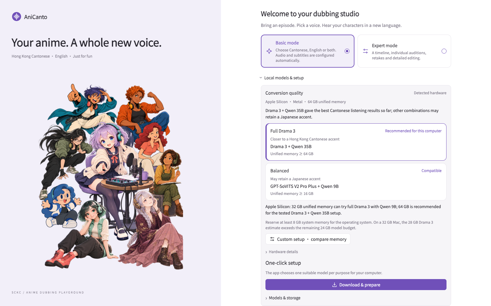

# First-run guide · 首次使用指南

[← AniCanto](../README.md)

This guide describes the current development workflow. Public downloads are not available in this repository yet.

以下係目前開發版嘅操作方式；儲存庫暫未提供正式下載。

## 1 · Prepare the recommended Mac / 準備建議硬件

Use an Apple Silicon Mac with 64 GB or more unified memory and macOS 14 or later. Reserve around 100 GB or more free space before model setup, plus additional working space for your videos.

建議 Apple Silicon Mac、64 GB 或以上統一記憶體、macOS 14 或以上。部署前預留約 100 GB 或以上可用空間，影片工作檔另計。

## 2 · Choose your models / 選擇模型

For the closest Hong Kong Cantonese accent heard in current developer tests, choose **Drama 3 + Qwen 3.5 35B**. Qwen is the translator and repair planner; Drama 3 generates speech. GPT-SoVITS and CosyVoice may retain Japanese intonation when using Japanese voice references. CosyVoice 3 is not offered on Mac.

想接近香港廣東話口音，建議 **Drama 3 + Qwen 3.5 35B**。Qwen 負責翻譯及修復判斷，Drama 3 負責配音。GPT-SoVITS、CosyVoice 使用日文聲線參考時可能有日語口音；Mac 唔提供 CosyVoice 3。

Read the model terms, then use **Download & prepare**. First setup needs the internet. The app keeps model downloads separate from projects and lets you inspect expected sources and SHA-256 checksums in About. These catalogue hashes are not a fresh verification of installed files; repair performs that separately.

閱讀模型條款後，按「一按準備使用」。首次部署需要網絡；模型同專案分開管理，About 可查看預期來源同 SHA-256。清單校驗碼唔等於剛核對已安裝檔案，修復時會另外驗證。

## 3 · Try one short original clip / 先試一段原創短片

Choose Basic mode, add a Japanese-language animation clip you are permitted to use, select Cantonese, English or both, and check the output folder. A short test lets you hear the selected model before processing an episode.

揀基本模式，加入有權使用嘅日文動畫短片，選廣東話、英文或雙語，再確認輸出資料夾。先試短片，可以聽清楚模型效果。

Original videos remain in their existing location. Queue order controls determine the order of waiting videos; pause and save before changing a running production.

原片保留喺原本位置；排序控制會調整待處理影片嘅先後，修改進行中製作前請先暫停保存。

## 4 · Let Normal mode check and repair / 用一般模式檢測修復

The app recognises dialogue, references subtitles, separates audio, translates, generates voices and attempts targeted quality repairs. OP/ED songs retain Japanese audio by default. Repair can take longer than initial generation.

流程會辨識對白、參考字幕、分離聲音、翻譯、配音，再針對問題嘗試修復。OP／ED 歌曲預設留日文；修復有時比初次生成更需時間。

High-speed mode deliberately omits quality review and quality-driven retakes. Choose Normal mode when you want those automatic checks.

高速模式會跳過品質核對及相關重錄；需要呢啲自動檢查時請用一般模式。

## 5 · Check the report and export / 查看報告同輸出

The review report distinguishes unfinished work from verified results. When available, compare the original mix, separated speech and generated take. Expert mode lets you edit the script, inspect the timeline, audition or retake a line, and export a new version while retaining earlier recordings and exports.

校對報告會分清未完成同已核對項目。檔案可用時，可以比較原裝混音、分離聲音及生成錄音。專家模式可執稿、瀏覽時間線、逐句試聽及重錄，再輸出新版本；舊錄音同成品會保留。

A labelled incomplete preview can contain original Japanese speech for unresolved lines. Do not mistake it for a fully verified Cantonese export. Hardware or model failures can still prevent an export.

未完整預覽可能喺未解決位置保留日文，唔等於完整廣東話配音；硬件或模型錯誤亦仍可能令輸出失敗。

## 6 · Learn by comparing / 用對照嚟探索廣東話

English speakers can keep the English interface and compare the original Japanese, Cantonese and English text/audio. Check unfamiliar names and expressions: the app can mistranslate, and generated speech is not an authoritative pronunciation model.

英語用戶可用英文介面，比較日文、廣東話及英文文字／音軌。人名同陌生用語記得核對：AI 可能譯錯，生成語音亦唔係權威發音教材。

## Voice consistency / 角色聲線一致性

Normal mode uses a source-voice reference for each line. The result is an imitation of that clip, not a guaranteed persistent voice identity. Even with Drama 3, accent, timbre and expression can change between takes. Optional role analysis may split one character or merge similar voices, especially when the original performer uses a wide emotional range.

一般模式逐句模擬原聲參考，唔保證同一角色全片保持完全一致。即使用 Drama 3，口音、音色同情緒仍可能有差異。選用角色分析時，原聲演繹變化大可能令 AI 將同一角色拆開，亦可能合併相似聲線。

AniCanto is a hobby project for learning and creative exploration. It does not replace professional dubbing. Please respect and support professional voice performers and use only voices and media you are permitted to process.

AniCanto 係學習同創作探索嘅興趣作品，唔會取代專業配音。請尊重及支持配音員，只使用有權處理嘅聲音同影音。
