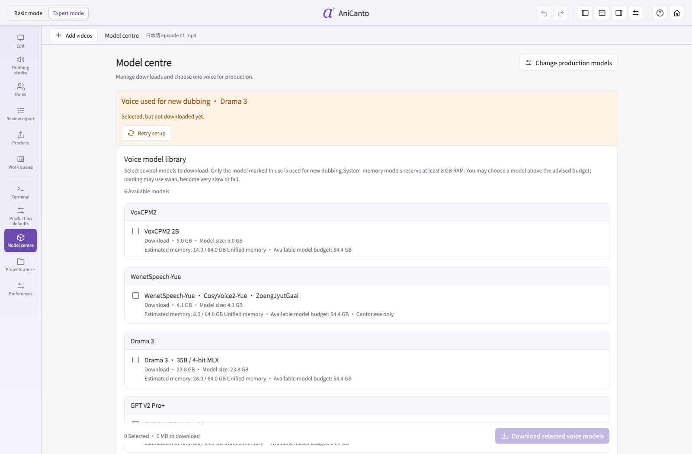

# Inside the current app · 0.24.64

[← AniCanto](../../README.md)

Editing screenshots show **video preview switched off, with the animated assistant visible**, in the light-purple theme. Project and model states are illustrative, not conversion benchmarks.

## Welcome

## Models & setup

## Basic mode

## Expert timeline

## Review report

## Video queue

## Model centre

## Preferences

## Subtitle source

## Dubbing studio and saved clips

## Windows: NVIDIA CUDA setup

