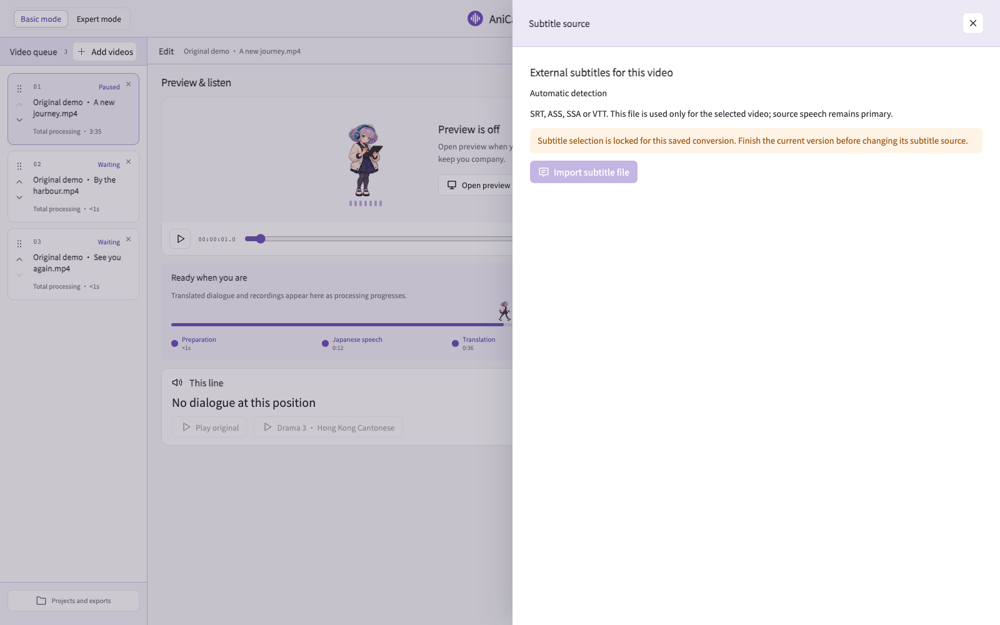

# Inside the current app · 0.24.58

[← AniCanto](../../README.en.md)

Real 0.24.58 interface with original demonstration material and illustrative model / project states; these screenshots are not conversion benchmarks.

## Welcome

## Models & setup

## Basic mode

## Expert timeline

## Review report

## Video queue

## Model centre

## Preferences

## Subtitle source

