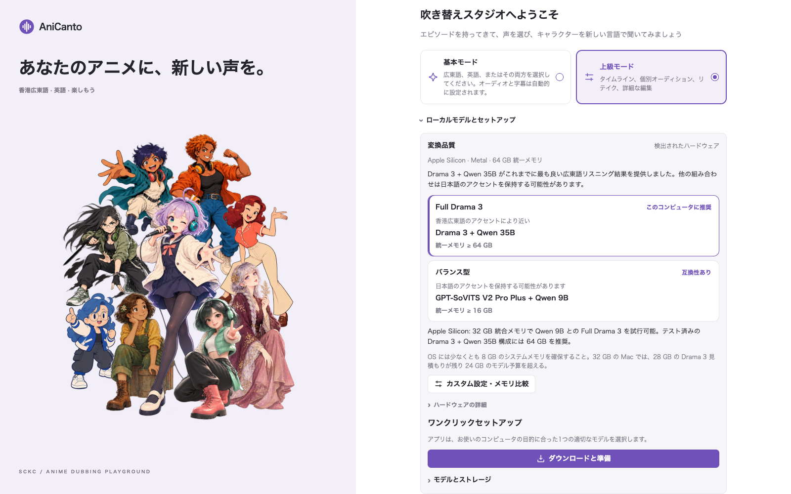
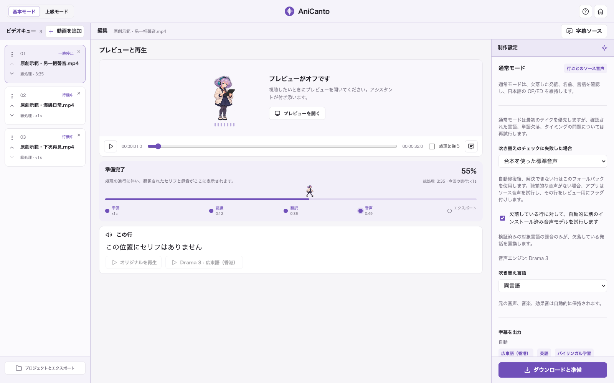
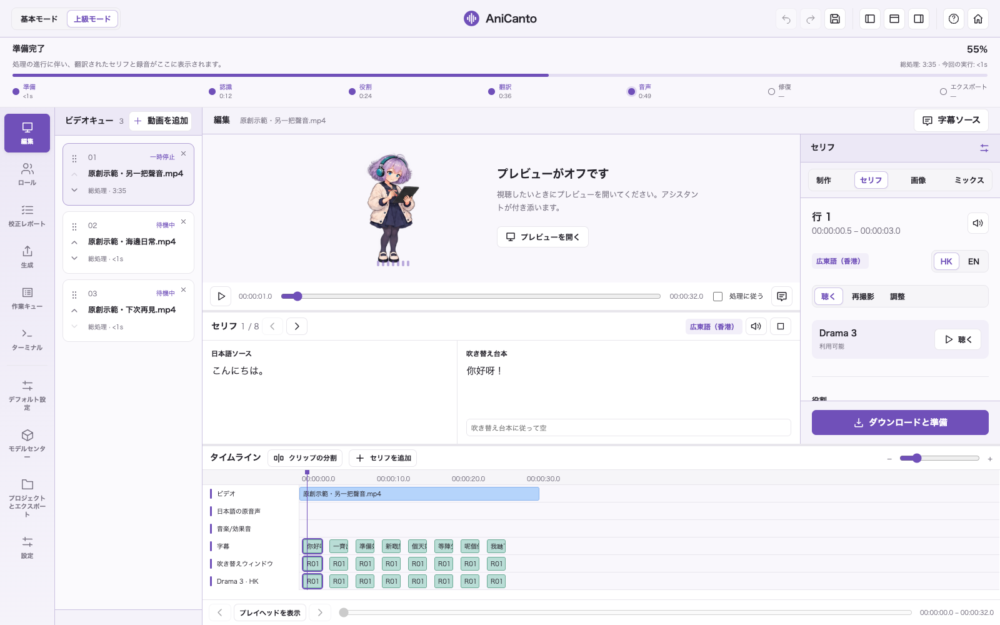
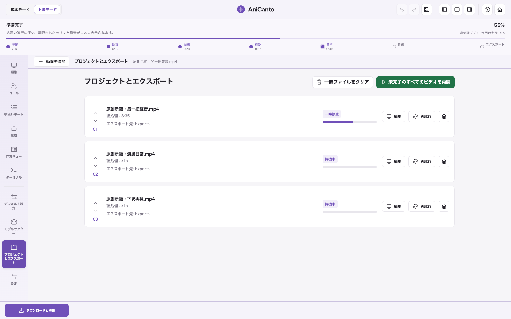
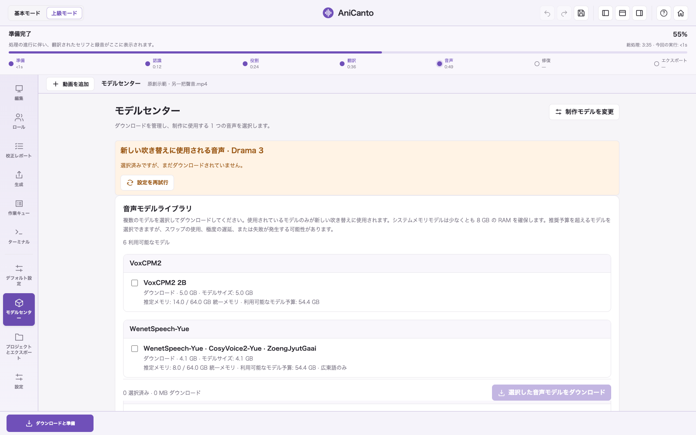
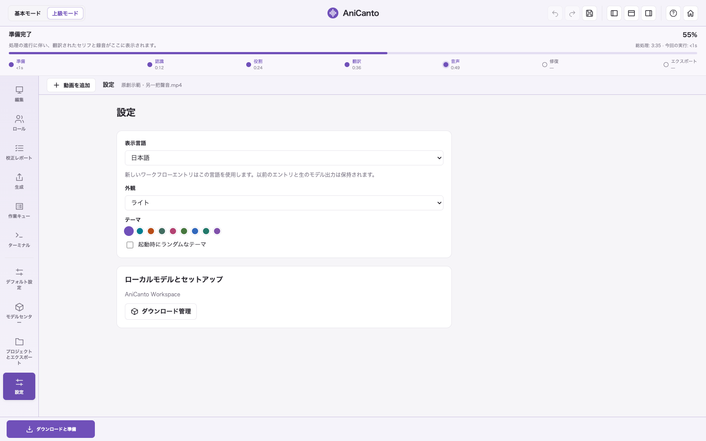
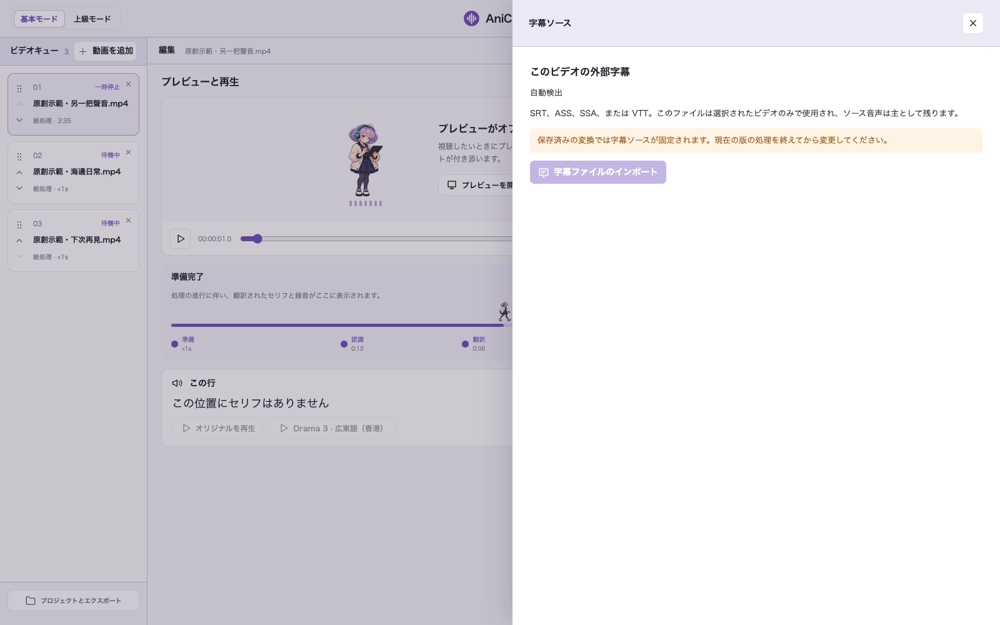

# 現在のアプリ画面 · 0.24.58

[← AniCanto](../../README.ja.md)

0.24.58 の実際の UI にオリジナルのデモ素材とモデル・プロジェクトの例を表示しています。処理性能の測定結果ではありません。

## ようこそ

## モデルとセットアップ

## 基本モード

## タイムライン

## 校正レポート

## 動画キュー

## モデルセンター

## 環境設定

## 字幕ソース

