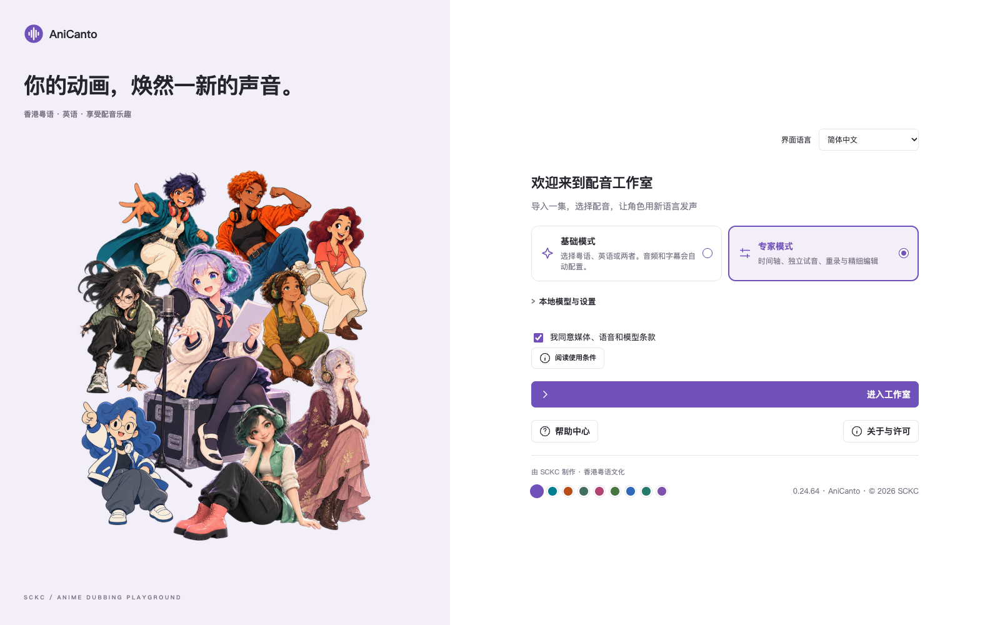
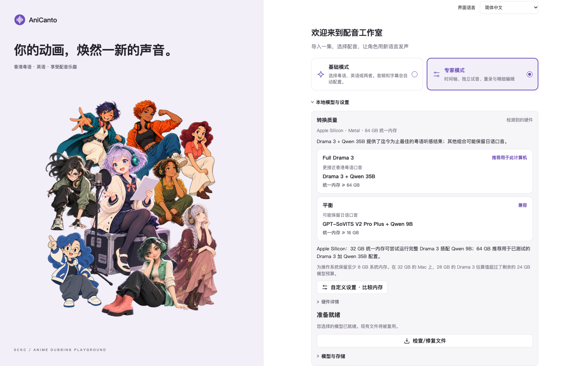
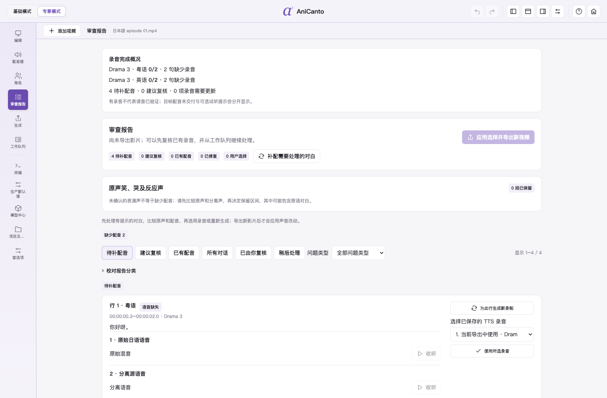
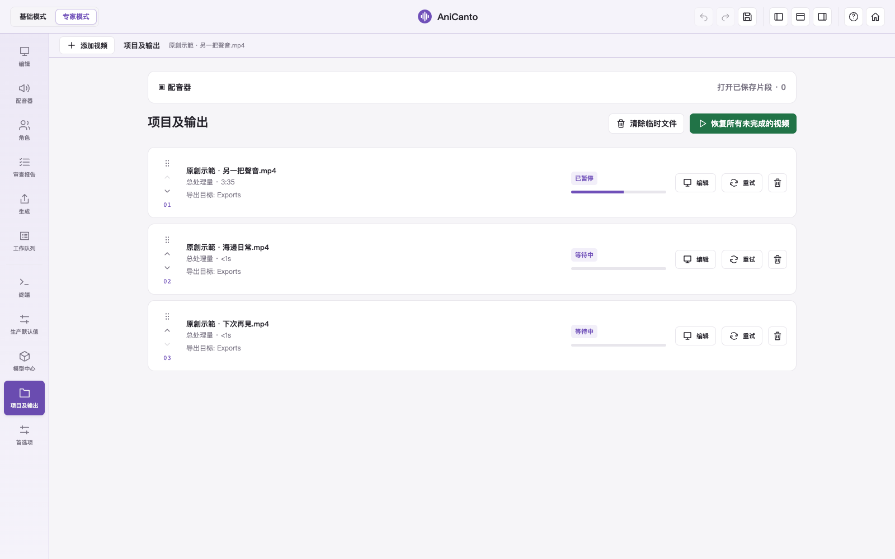
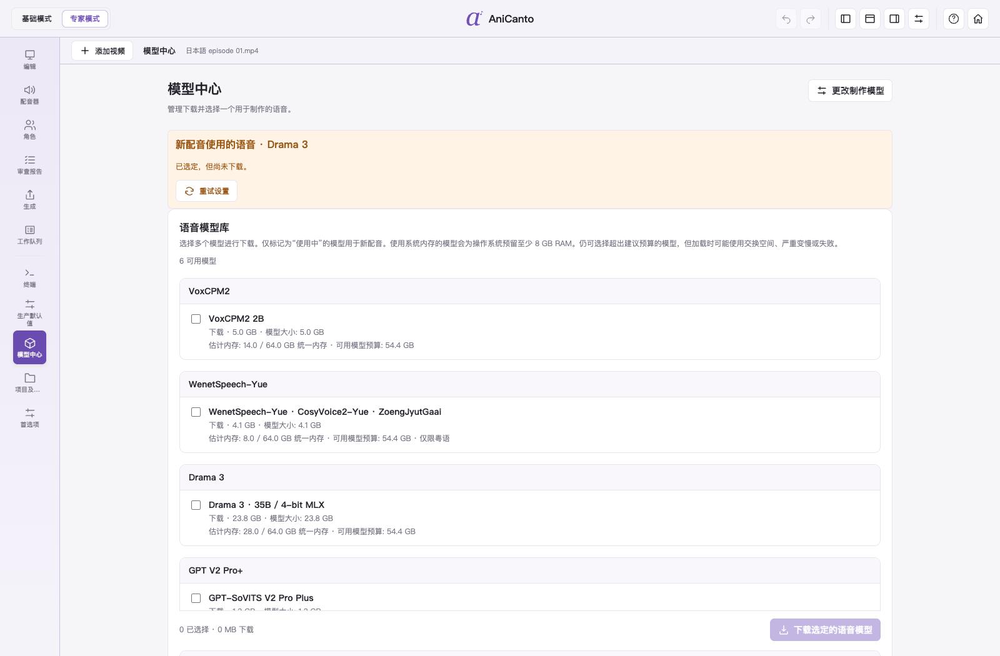
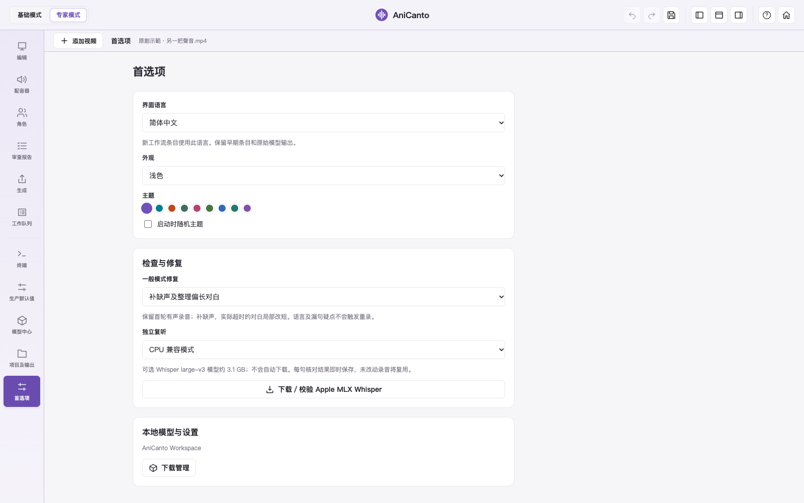

# 新版界面 · 0.24.64

[← AniCanto](../../README.zh-CN.md)

以下为 0.24.63 真实界面。剪辑画面统一使用浅紫色主题，**关闭视频预览，显示动画小助手**；模型及项目状态仅作演示，不代表转换性能测试。

## 欢迎画面

## 模型与部署

## 基本模式

## 专家时间轴

## 校对报告

## 视频列表

## 模型中心

## 偏好设置

## 字幕来源

## 配音器与已保存片段

## Windows：NVIDIA CUDA 部署

