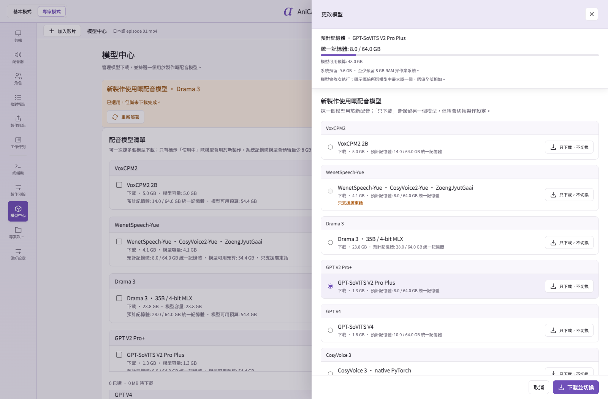
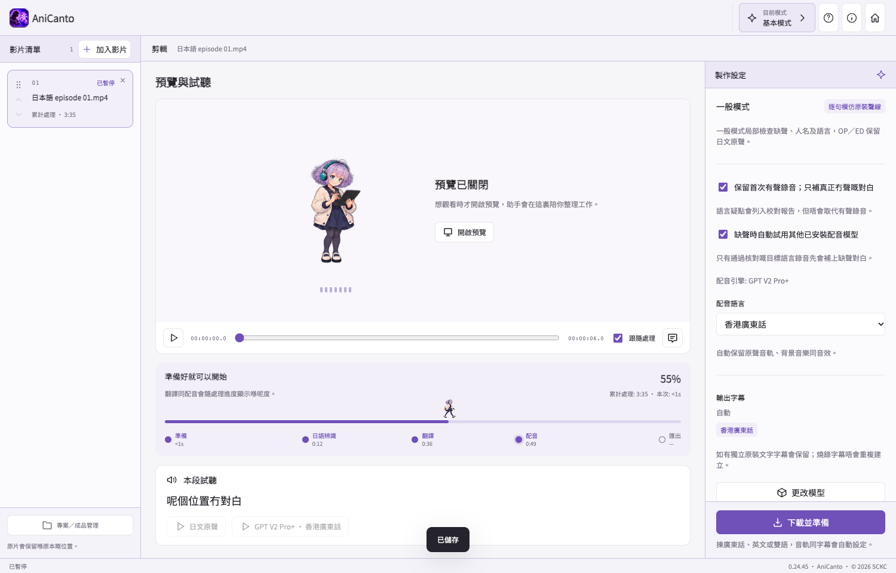
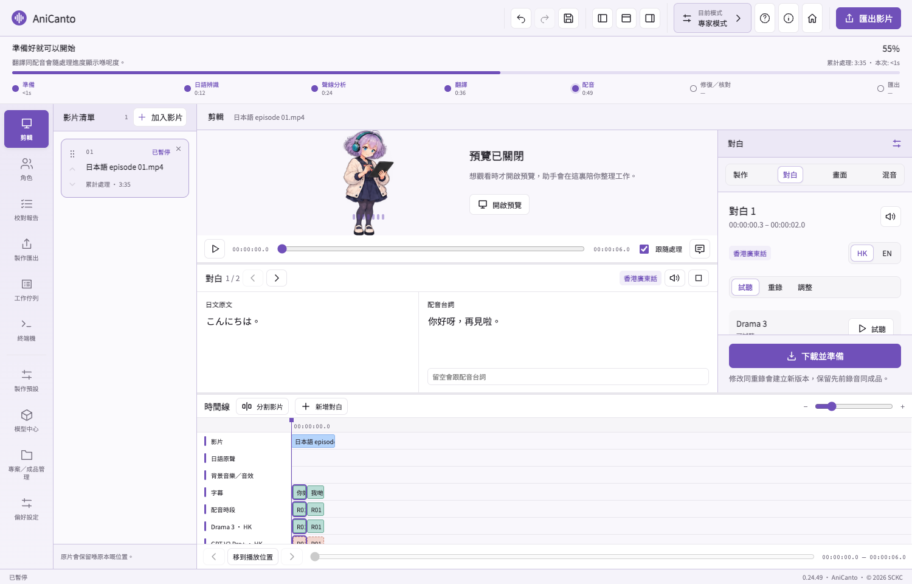
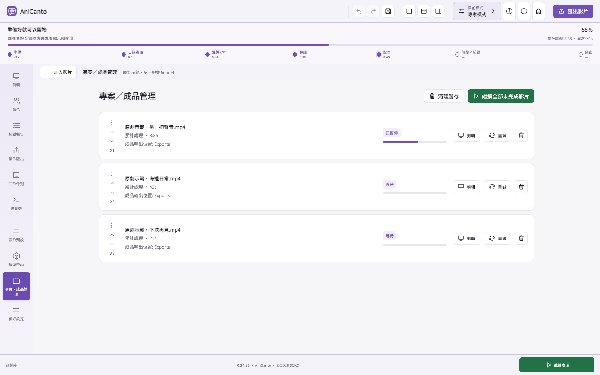
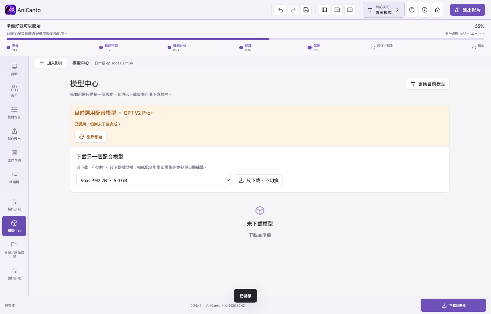
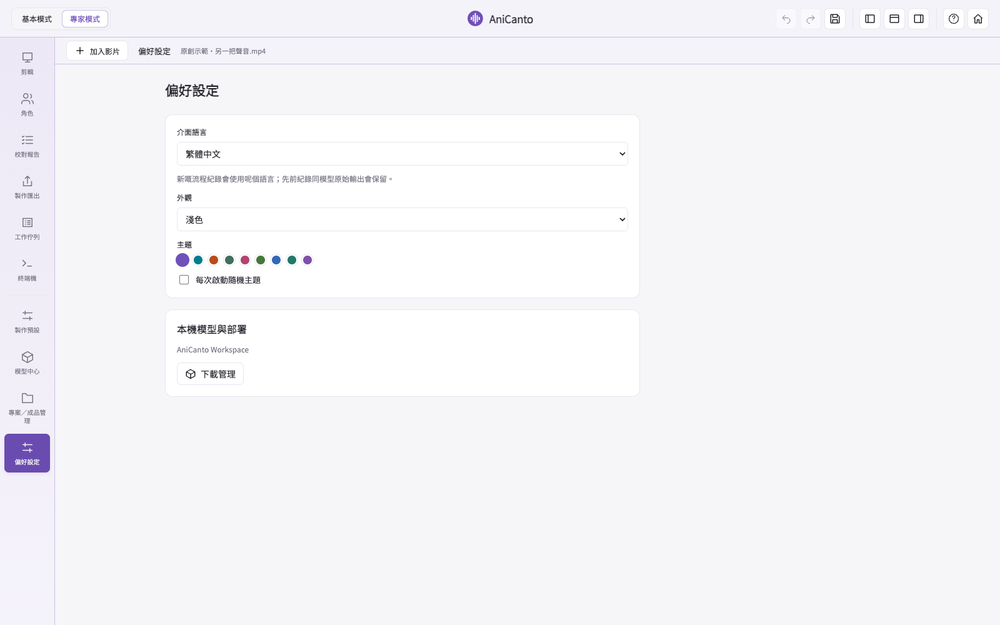

**繁體中文** · [English](../SCREENSHOTS.md)

# 介面圖集

[← AniCanto](../../README.md)

App 主要以**香港繁體中文**設計，另設**英文介面**，方便對廣東話有興趣嘅英語人士使用。本圖集全部使用繁中介面截圖；頂部語言連結可切換到完整英文圖集。

截圖來自實際 App，使用原創示範對白同示意模型／專案狀態，用嚟介紹介面，唔係完整轉換或效能證明。按圖片可以放大查看。

## 歡迎畫面

## 模型及準備

## 基本模式

## 專家時間軸

## 校對報告

## 專案及工作清單

## 模型中心

## 偏好設定

